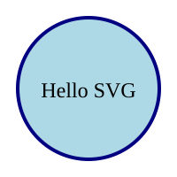

# HTML

HTML, or HyperText Markup Language, is the standard language used to create and design web pages.

Author

Benedict Thekkel

## Basic Structure of HTML

- Doctype Declaration: At the top of every HTML document, you declare the document type with `<!DOCTYPE html>`. This tells the browser that the page is written in HTML5.
- HTML Tag (`<html>`): The root element that contains all other elements.
- Head Section (`<head>`): Contains meta-information about the document, like the title (`<title>`), character set (`<meta charset="UTF-8">`), and links to CSS or JavaScript files.
- Body Section (`<body>`): Contains the content of the web page, such as text, images, links, and other media.

> Basic Example

``` html
<!DOCTYPE html>
<html>
  <head>
    <meta charset="UTF-8">
    <title>My First HTML Page</title>
  </head>
  <body>
    <h1>Hello, World!</h1>
    <p>This is a paragraph of text.</p>
  </body>
</html>
```

## HTML Tags and Elements

- Tags: Keywords enclosed in angle brackets (e.g., `<tagname>`). Tags usually come in pairs with an opening tag (`<tag>`) and a closing tag (`</tag>`), though some tags are self-closing (e.g., ``).
- Elements: The complete structure from the opening tag to the closing tag, including the content between them (e.g., `<p>`This is a paragraph.`</p>`).

## Common HTML Tags

- Headings: `<h1>` to `<h6>` tags, where `<h1>` is the highest level and `<h6>` is the lowest.
- Paragraphs: `<p>` tag for text blocks.
- Links: `<a href="URL">Link Text</a>` for creating hyperlinks.
- Images: `` for embedding images.
- Lists:
  - Unordered: `<ul>` with `<li>` for each list item.
  - Ordered: `<ol>` with `<li>` for each list item.
- Tables: `<table>` containing `<tr>` (table rows), `<th>` (table headers), and `<td>` (table data).
- Forms: `<form>` for creating user input fields, with various input types like `<input>`, `<textarea>`, and `<select>`.

### Examples:

> Heading
>
> ### qsdfasdfadf

> Link [Google Link](www.google.com)

> Ordered List
>
> 1.  q
> 2.  w
>     1.  e
>     2.  r

> Unordered List
>
> - asdf
> - vrewea
>   - asdf

### Table

Table Attributes: - `border`: Specifies the width of the border around the table and cells. - `cellpadding`: Defines the space between the cell content and the cell borders. - `cellspacing`: Defines the space between individual table cells. - `width and height`: Define the dimensions of the table or cells. - `align`: Aligns the table on the page (left, center, right). - `bgcolor`: Sets the background color of the table or cells (deprecated in favor of CSS).

> Example
>
> | Main Title    |             |       |
> |---------------|-------------|-------|
> | Student Name  | Subject     | Grade |
> | John Doe      | Mathematics | A     |
> | Jane Smith    | Science     | B+    |
> | Emily Johnson | History     | A-    |

| Main Title    |             |       |
|---------------|-------------|-------|
| Student Name  | Subject     | Grade |
| John Doe      | Mathematics | A     |
| Jane Smith    | Science     | B+    |
| Emily Johnson | History     | A-    |

## Attributes

- Global Attributes: Common to all elements, like id, class, style, and title.
- Specific Attributes: Relevant to particular tags, like href for `<a>`, src for ``, and action for `<form>`

> Example

``` html
<a href="https://www.example.com" title="Example Website">Visit Example</a>
```

## Semantic HTML

> Purpose: To provide meaning to web content, helping both browsers and developers understand the structure of the web page.

------------------------------------------------------------------------

> Examples: - `<header>` for page headers. - `<nav>` for navigation links. - `<article>` for self-contained content. - `<section>` for distinct sections of content. - `<footer>` for page footers.

## HTML Forms

> Used for collecting user input.

------------------------------------------------------------------------

Common elements include: - `<input>` for single-line text fields, checkboxes, radio buttons, etc. - `<textarea>` for multi-line text input. - `<button>` for clickable buttons. - `<select>` for dropdown lists.

> Example:

``` html
<form action="WEB_doc/Front_end/html.html" method="POST">
  <label for="name">Name:</label>
  <input type="text" id="name" name="name">
  <button type="submit">Submit</button>
</form>
```

Name:

Submit

## Registration Form

Personal Information First Name: Last Name: Email: Phone Number:

Account Information Username: Password: Confirm Password:

Preferences Preferred Contact Method: Email Phone Subscribe to our newsletter:

Yes, sign me up! Country: United States Canada United Kingdom Australia

Profile Picture Upload a profile picture:

Register

Reset

## HTML5 New Features

- New Elements: `<article>`, `<aside>`, `<figure>`, `<figcaption>`, `<footer>`, `<header>`, `<nav>`, `<section>`, `<main>`, etc.
- Audio and Video: `<audio` nd `<video>` tags allow embedding multimedia without third-party plugins.
- Canvas and SVG: `<canvas>` for drawing graphics on the fly, `<svg>` for scalable vector graphics.
- Local Storage: localStorage and sessionStorage for storing data on the client-side.
- Geolocation API: For accessing the user’s location.
- Forms Enhancements: New input types like date, email, range, search, tel, url, and more.

------------------------------------------------------------------------

## Accessibility in HTML

- ARIA (Accessible Rich Internet Applications): Attributes like aria-label, aria-hidden, etc., to improve accessibility.
- Alt Text: The alt attribute in images provides text descriptions for screen readers.
- Semantic Elements: Using proper tags like `<nav>`, `<header>`, etc., for better navigation for assistive technologies.

``` python
from IPython.display import SVG, display

display(SVG("""
<svg width="200" height="200" xmlns="http://www.w3.org/2000/svg">
  <circle cx="100" cy="100" r="80" fill="lightblue" stroke="navy" stroke-width="4"/>
  <text x="100" y="110" font-size="24" text-anchor="middle" fill="black">
    Hello SVG
  </text>
</svg>
"""))
```



Back to top
