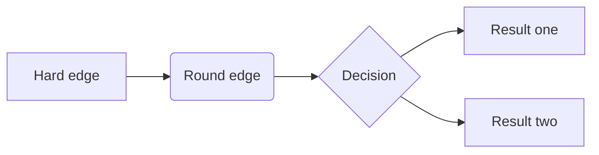

# Markdown

MarkdowMarkdown is a lightweight markup language for creating formatted text using a plain-text editor. It’s widely used for documentation, websites, notes, and more due to its simplicity and readability.

Author

Benedict Thekkel

## **1. Basic Text Formatting**

### **Bold**

``` markdown
**This is bold text**
__This is bold text__
```

**This is bold text**

### **Italic**

``` markdown
*This is italic text*
_This is italic text_
```

*This is italic text*

### **Bold and Italic**

``` markdown
***This is bold and italic***
___This is bold and italic___
```

***This is bold and italic***

### **Strikethrough**

``` markdown
~~This text is struck through~~
```

~~This text is struck through~~

------------------------------------------------------------------------

## **2. Headings**

``` markdown
# Heading 1
## Heading 2
### Heading 3
#### Heading 4
##### Heading 5
###### Heading 6
```

### Heading 3

#### Heading 4

##### Heading 5

###### Heading 6

------------------------------------------------------------------------

## **3. Lists**

### **Ordered List**

``` markdown
1. First item
2. Second item
   1. Sub-item
   2. Sub-item
3. Third item
```

1.  First item\
2.  Second item
    1.  Sub-item\
    2.  Sub-item\
3.  Third item

### **Unordered List**

``` markdown
- First item
- Second item
  - Sub-item
  - Sub-item
- Third item
```

- First item\
- Second item
  - Sub-item\
  - Sub-item\
- Third item

------------------------------------------------------------------------

## **4. Links**

``` markdown
[Clickable text](https://example.com)
```

[Clickable text](https://example.com)

### **Reference-style Links**

``` markdown
[Clickable text][1]

[1]: https://example.com
```

------------------------------------------------------------------------

## **5. Images**

``` markdown

```


Alt text

------------------------------------------------------------------------

## **6. Code**

### **Inline Code**

``` markdown
`Inline code`
```

`Inline code`

### **Code Block**

``` markdown
```

Code block

For specific languages:

``` markdown
\```python
print("Hello, World!")
\```
```

------------------------------------------------------------------------

## **7. Blockquotes**

``` markdown
> This is a blockquote
>> Nested blockquote
```

> This is a blockquote\
> \> Nested blockquote

------------------------------------------------------------------------

## **9. Tables**

``` markdown
| Column 1 | Column 2 | Column 3 |
|----------|----------|----------|
| Value 1  | Value 2  | Value 3  |
| Value A  | Value B  | Value C  |
```

| Column 1 | Column 2 | Column 3 |
|----------|----------|----------|
| Value 1  | Value 2  | Value 3  |
| Value A  | Value B  | Value C  |

| Col1 | Col2 | Col3 |
|:-----|:-----|:-----|
| A    | B    | C    |
| E    | F    | G    |
| A    | G    | G    |

\(a\) First Table

| Col1 | Col2 | Col3 |
|:-----|:-----|:-----|
| A    | B    | C    |
| E    | F    | G    |
| A    | G    | G    |

\(b\) Second Table

Table 1: Main Caption

------------------------------------------------------------------------

## **10. Task Lists**

``` markdown
- [x] Completed task
- [ ] Incomplete task
```

Completed task\

Incomplete task

------------------------------------------------------------------------

## **11. Escaping Characters**

To include Markdown characters as literal text, use a backslash (`\`):

``` markdown
\*Literal asterisk\*
```

\*Literal asterisk\*

------------------------------------------------------------------------

## **12. Advanced Syntax**

### **Footnotes**

``` markdown
This is a sentence with a footnote.[^1]

[^1]: This is the footnote text.
```

This is a sentence with a footnote.[^1]

------------------------------------------------------------------------

### **Definition Lists**

``` markdown
Term 1
: Definition 1

Term 2
: Definition 2
```

Term 1  
Definition 1

Term 2  
Definition 2

------------------------------------------------------------------------

## **13. HTML in Markdown**

You can include raw HTML for additional formatting:

``` markdown
<div style="color: blue;">This text is blue</div>
```

This text is blue

------------------------------------------------------------------------

## **14. Extensions**

Many Markdown processors support extended syntax: - **Math** (e.g., LaTeX): `markdown $$E = mc^2$$` (E = mc^2)

- **Mermaid Diagrams** (rendered live in the demo below):

  ```` markdown
  ```mermaid
  graph TD;
      A-->B;
  ```
  ````

------------------------------------------------------------------------

## 15. Diagrams

![](data:image/svg+xml;base64,PHN2ZyB3aWR0aD0iNjcyIiBoZWlnaHQ9IjQ4MCIgdmlld2JveD0iMC4wMCAwLjAwIDEzNC4wMCAxODguMDAiIHhtbG5zPSJodHRwOi8vd3d3LnczLm9yZy8yMDAwL3N2ZyIgeGxpbms9Imh0dHA6Ly93d3cudzMub3JnLzE5OTkveGxpbmsiIHN0eWxlPSI7IG1heC13aWR0aDogbm9uZTsgbWF4LWhlaWdodDogbm9uZSI+CjxnIGlkPSJncmFwaDAiIGNsYXNzPSJncmFwaCIgdHJhbnNmb3JtPSJzY2FsZSgxIDEpIHJvdGF0ZSgwKSB0cmFuc2xhdGUoNCAxODQpIj4KPHBvbHlnb24gZmlsbD0id2hpdGUiIHN0cm9rZT0idHJhbnNwYXJlbnQiIHBvaW50cz0iLTQsNCAtNCwtMTg0IDEzMCwtMTg0IDEzMCw0IC00LDQiPjwvcG9seWdvbj4KPCEtLSBBIC0tPgo8ZyBpZD0ibm9kZTEiIGNsYXNzPSJub2RlIj4KPHRpdGxlPkE8L3RpdGxlPgo8ZWxsaXBzZSBmaWxsPSJub25lIiBzdHJva2U9ImJsYWNrIiBjeD0iNjMiIGN5PSItMTYyIiByeD0iMjciIHJ5PSIxOCI+PC9lbGxpcHNlPgo8dGV4dCB0ZXh0LWFuY2hvcj0ibWlkZGxlIiB4PSI2MyIgeT0iLTE1Ny44IiBmb250LWZhbWlseT0iVGltZXMsc2VyaWYiIGZvbnQtc2l6ZT0iMTQuMDAiPkE8L3RleHQ+CjwvZz4KPCEtLSBCIC0tPgo8ZyBpZD0ibm9kZTIiIGNsYXNzPSJub2RlIj4KPHRpdGxlPkI8L3RpdGxlPgo8ZWxsaXBzZSBmaWxsPSJub25lIiBzdHJva2U9ImJsYWNrIiBjeD0iMjciIGN5PSItOTAiIHJ4PSIyNyIgcnk9IjE4Ij48L2VsbGlwc2U+Cjx0ZXh0IHRleHQtYW5jaG9yPSJtaWRkbGUiIHg9IjI3IiB5PSItODUuOCIgZm9udC1mYW1pbHk9IlRpbWVzLHNlcmlmIiBmb250LXNpemU9IjE0LjAwIj5CPC90ZXh0Pgo8L2c+CjwhLS0gQSYjNDU7Jmd0O0IgLS0+CjxnIGlkPSJlZGdlMSIgY2xhc3M9ImVkZ2UiPgo8dGl0bGU+QS0mZ3Q7QjwvdGl0bGU+CjxwYXRoIGZpbGw9Im5vbmUiIHN0cm9rZT0iYmxhY2siIGQ9Ik01NC42NSwtMTQ0Ljc2QzUwLjI5LC0xMzYuMjggNDQuODUsLTEyNS43MSAzOS45NiwtMTE2LjIiIC8+Cjxwb2x5Z29uIGZpbGw9ImJsYWNrIiBzdHJva2U9ImJsYWNrIiBwb2ludHM9IjQyLjk5LC0xMTQuNDQgMzUuMywtMTA3LjE1IDM2Ljc3LC0xMTcuNjQgNDIuOTksLTExNC40NCI+PC9wb2x5Z29uPgo8L2c+CjwhLS0gQyAtLT4KPGcgaWQ9Im5vZGUzIiBjbGFzcz0ibm9kZSI+Cjx0aXRsZT5DPC90aXRsZT4KPGVsbGlwc2UgZmlsbD0ibm9uZSIgc3Ryb2tlPSJibGFjayIgY3g9Ijk5IiBjeT0iLTkwIiByeD0iMjciIHJ5PSIxOCI+PC9lbGxpcHNlPgo8dGV4dCB0ZXh0LWFuY2hvcj0ibWlkZGxlIiB4PSI5OSIgeT0iLTg1LjgiIGZvbnQtZmFtaWx5PSJUaW1lcyxzZXJpZiIgZm9udC1zaXplPSIxNC4wMCI+QzwvdGV4dD4KPC9nPgo8IS0tIEEmIzQ1OyZndDtDIC0tPgo8ZyBpZD0iZWRnZTIiIGNsYXNzPSJlZGdlIj4KPHRpdGxlPkEtJmd0O0M8L3RpdGxlPgo8cGF0aCBmaWxsPSJub25lIiBzdHJva2U9ImJsYWNrIiBkPSJNNzEuMzUsLTE0NC43NkM3NS43MSwtMTM2LjI4IDgxLjE1LC0xMjUuNzEgODYuMDQsLTExNi4yIiAvPgo8cG9seWdvbiBmaWxsPSJibGFjayIgc3Ryb2tlPSJibGFjayIgcG9pbnRzPSI4OS4yMywtMTE3LjY0IDkwLjcsLTEwNy4xNSA4My4wMSwtMTE0LjQ0IDg5LjIzLC0xMTcuNjQiPjwvcG9seWdvbj4KPC9nPgo8IS0tIEQgLS0+CjxnIGlkPSJub2RlNCIgY2xhc3M9Im5vZGUiPgo8dGl0bGU+RDwvdGl0bGU+CjxlbGxpcHNlIGZpbGw9Im5vbmUiIHN0cm9rZT0iYmxhY2siIGN4PSI2MyIgY3k9Ii0xOCIgcng9IjI3IiByeT0iMTgiPjwvZWxsaXBzZT4KPHRleHQgdGV4dC1hbmNob3I9Im1pZGRsZSIgeD0iNjMiIHk9Ii0xMy44IiBmb250LWZhbWlseT0iVGltZXMsc2VyaWYiIGZvbnQtc2l6ZT0iMTQuMDAiPkQ8L3RleHQ+CjwvZz4KPCEtLSBCJiM0NTsmZ3Q7RCAtLT4KPGcgaWQ9ImVkZ2UzIiBjbGFzcz0iZWRnZSI+Cjx0aXRsZT5CLSZndDtEPC90aXRsZT4KPHBhdGggZmlsbD0ibm9uZSIgc3Ryb2tlPSJibGFjayIgZD0iTTM1LjM1LC03Mi43NkMzOS43MSwtNjQuMjggNDUuMTUsLTUzLjcxIDUwLjA0LC00NC4yIiAvPgo8cG9seWdvbiBmaWxsPSJibGFjayIgc3Ryb2tlPSJibGFjayIgcG9pbnRzPSI1My4yMywtNDUuNjQgNTQuNywtMzUuMTUgNDcuMDEsLTQyLjQ0IDUzLjIzLC00NS42NCI+PC9wb2x5Z29uPgo8L2c+CjwhLS0gQyYjNDU7Jmd0O0QgLS0+CjxnIGlkPSJlZGdlNCIgY2xhc3M9ImVkZ2UiPgo8dGl0bGU+Qy0mZ3Q7RDwvdGl0bGU+CjxwYXRoIGZpbGw9Im5vbmUiIHN0cm9rZT0iYmxhY2siIGQ9Ik05MC42NSwtNzIuNzZDODYuMjksLTY0LjI4IDgwLjg1LC01My43MSA3NS45NiwtNDQuMiIgLz4KPHBvbHlnb24gZmlsbD0iYmxhY2siIHN0cm9rZT0iYmxhY2siIHBvaW50cz0iNzguOTksLTQyLjQ0IDcxLjMsLTM1LjE1IDcyLjc3LC00NS42NCA3OC45OSwtNDIuNDQiPjwvcG9seWdvbj4KPC9nPgo8L2c+Cjwvc3ZnPg==)



## 16. Callouts

> **NOTE:**
>
> Note that there are five types of callouts, including: `note`, `warning`, `important`, `tip`, and `caution`.

> **TIP:**
>
> This is an example of a callout with a title.

> **CAUTION:**
>
> ------------------------------------------------------------------------
>
> ## Expand To Learn About Collapse
>
> This is an example of a ‘folded’ caution callout that can be expanded by the user. You can use `collapse="true"` to collapse it by default or `collapse="false"` to make a collapsible callout that is expanded by default.

------------------------------------------------------------------------

## Shortcuts and Tricks

### Command Mode Shortcuts

There are a couple of useful keyboard shortcuts in `Command Mode` that you can leverage to make Jupyter Notebook faster to use. Remember that you can switch back and forth between `Command Mode` and `Edit Mode` with Esc and Enter.

- m:: Convert cell to Markdown
- y:: Convert cell to Code
- d+d:: Delete cell
- o:: Toggle between hide or show output
- Shift+Arrow up/Arrow down:: Select multiple cells. Once you have selected them you can operate on them like a batch (run, copy, paste etc).
- Shift+M:: Merge selected cells

### Cell Tricks

There are also some tricks that you can code into a cell:

- `?function-name`:: Shows the definition and docstring for that function
- `??function-name`:: Shows the source code for that function
- `doc(function-name)`:: Shows the definition, docstring **and links to the documentation** of the function (only works with fastai library imported)
- Shift+Tab (press once):: See which parameters to pass to a function
- Shift+Tab (press three times):: Get additional information on the method

Here’s an example of using `?` to learn about Python’s `print()` function:

Back to top

## Footnotes

[^1]: This is the footnote text.
