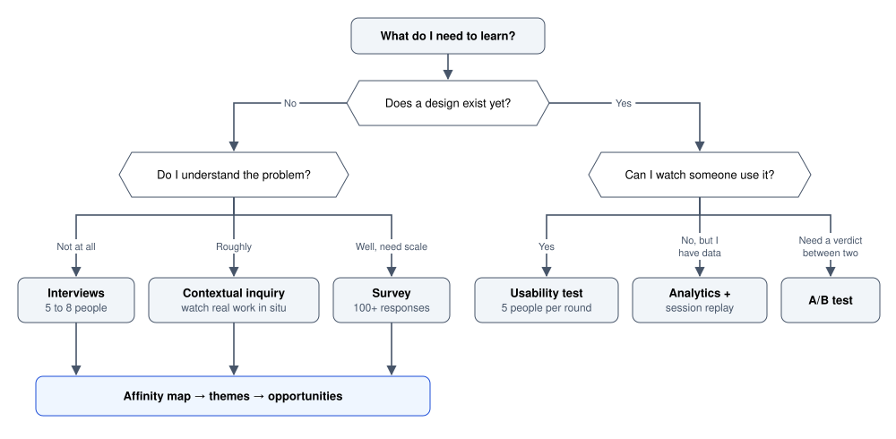
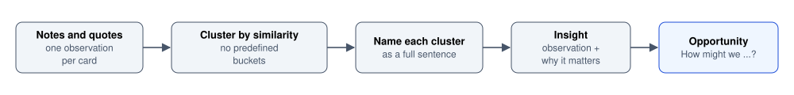

# UX Research

Finding out what people are actually trying to do, before anyone draws a screen.

Author

Benedict Thekkel

Research exists to answer one question: **are we building the right thing?** Everything downstream, the information architecture, the flows, the colour tokens, is craft applied to an assumption. If the assumption is wrong then the craft makes a well-built wrong thing.

The trap is that the assumption feels like knowledge. You have used software, you have opinions, and the person asking for the feature has opinions too. Research is the discipline of converting those opinions into evidence cheaply enough that you actually do it.

Two distinctions organise every method in this notebook:

|  | **What people say** (attitudinal) | **What people do** (behavioural) |
|----|----|----|
| **Explore** (generative, before a design exists) | Interviews, diary studies, focus groups | Contextual inquiry, field study, log analysis |
| **Evaluate** (evaluative, once something exists) | Surveys, satisfaction scores, feedback forms | Usability testing, A/B tests, analytics funnels |

Attitudinal data tells you about motivation and mental models. Behavioural data tells you the truth about actions. When they disagree, believe the behaviour. People are reliable narrators of what they want and unreliable narrators of what they do.

This notebook is the left column of that table, the generative half. The right-hand evaluative half lives in [Usability Evaluation](../UI_UX/usability_evaluation.llms.md) and [Measurement and Experimentation](../UI_UX/measurement_and_experimentation.llms.md).

------------------------------------------------------------------------

## 1. Picking a method

Method choice follows from the question, not from preference. Work backwards from what you need to learn.

Decision tree for picking a research method: if no design exists, interviews, contextual inquiry or a survey depending on how well you understand the problem, all feeding an affinity map, themes and opportunities; if a design exists, a usability test, analytics with session replay, or an A/B test depending on whether you can watch use, only have data, or need a verdict between two.

Two rules that save most of the wasted effort:

- **Never run a survey to explore.** A survey can only return answers to questions you already knew to ask. Explore with interviews, then use a survey to size what you found.
- **Never ask people to predict their behaviour.** “Would you use a feature that …” reliably returns yes and predicts nothing. Ask about the last time they faced the problem instead.

------------------------------------------------------------------------

## 2. Interviews

The workhorse method. One person, 45 to 60 minutes, semi-structured, aimed at past behaviour rather than future intentions.

**Structure.** Open with easy context questions to settle the person. Move to the specific episode you care about. Close with a broad sweep for anything you did not think to ask.

**Ask about specific past episodes.** The single highest-leverage habit in the whole method:

| Instead of | Ask |
|----|----|
| “Would you use a shared dashboard?” | “Walk me through the last time you needed a number from someone else’s report.” |
| “Is the export slow?” | “Tell me about the last export you ran. What did you do while it went?” |
| “What features do you want?” | “What was the most annoying part of last week?” |
| “Do you find it confusing?” | “Show me where you would go to change your billing address.” |

**Questions to avoid.**

- *Leading*: “How useful was the new summary panel?” presumes it was useful. Ask “what did you make of the summary panel?”
- *Compound*: “Was it fast and easy to find?” returns one answer to two questions.
- *Hypothetical*: covered above.
- *Solution-shaped*: if you ask what they want, you get a feature request that describes their workaround, not their problem. Ask about the problem and design the solution yourself.

**The five whys, used gently.** When somebody states a preference, ask why, up to a few times, until you reach a motivation rather than a habit. Stop before it becomes an interrogation.

**Recording.** Record audio with permission, take sparse notes so you can keep eye contact, and write up within the same day while tone of voice is still in your memory. Verbatim quotes are the currency: a quote survives the retelling to a stakeholder, a paraphrase does not.

------------------------------------------------------------------------

## 3. Contextual inquiry and field studies

An interview in the place where the work happens, with the work happening. You watch, then ask about what you saw. The framing is a **master and apprentice** relationship: they are the expert, you are learning the job.

What this catches that an interview cannot:

- **The workarounds people no longer notice.** The spreadsheet beside the app. The sticky note with the reference numbers. The habit of filling a field with a dot because it is required and they do not have the value yet. Nobody reports these, because to them it is just how the job is done.
- **Interruptions.** Real work is interleaved. A flow that assumes ten uninterrupted minutes fails in a room where the phone rings.
- **The physical and social context.** Gloves. Bright sun. A screen visible to customers. A supervisor watching. Latency on a warehouse Wi-Fi network.

**Method.** Watch quietly first. Ask “what are you doing now?” rather than “why did you do that?”, which reads as a challenge. Photograph the workspace if allowed, since the artefacts around the screen are data. Two hours in situ routinely beats five remote interviews.

------------------------------------------------------------------------

## 4. Surveys

Surveys measure known quantities at scale. They are the wrong instrument for discovery and the right one for sizing.

**Good uses:** how many people hit a problem you already found, which of five known pain points ranks worst, segment sizes, satisfaction tracked over time.

**Writing questions that survive.**

- One idea per question.
- Use a balanced scale with an odd number of points (5 or 7) and label every point, not just the ends.
- Avoid “usually” and “often”. Ask “how many times in the last seven days”.
- Randomise option order where order could bias the answer.
- Put demographics last. They are boring and cause abandonment if they come first.
- Include an explicit “not applicable” so people are not forced into a false answer.

**Sampling is the part that goes wrong.** A survey emailed to your newsletter list measures the opinions of people engaged enough to be on a newsletter list. That is survivorship bias, and it systematically hides the experience of the people who left. If you need to hear from churned users, you have to go and find them.

**Response rate maths.** For a population of any size, roughly 380 responses gives a 5 percent margin of error at 95 percent confidence. Below about 100 responses, treat the numbers as directional and quote the free-text answers instead, because the free text is usually the valuable part anyway.

------------------------------------------------------------------------

## 5. Diary studies

Participants log their own experience over days or weeks, prompted once or twice a day. Use one when the behaviour you care about is spread over time, is private, or is too infrequent to observe: onboarding over a first fortnight, a monthly reporting cycle, symptom tracking, anything seasonal.

**Practicalities.** Keep each entry under two minutes or compliance collapses. Prompt by the channel the person already lives in. Expect to lose a third of participants, so over-recruit. Pay people, because you are asking for three weeks of small obligations.

**Pair it with an exit interview.** The diary gives you the moments; the interview gives you the meaning.

------------------------------------------------------------------------

## 6. Making sense of it: affinity mapping

Raw notes are not findings. The standard synthesis is bottom-up clustering.

Affinity mapping pipeline from left to right: notes and quotes with one observation per card, clustered by similarity without predefined buckets, each cluster named as a full sentence, turned into an insight (observation plus why it matters), then an opportunity phrased as How might we.

**One observation per card.** If a card contains two ideas it will be filed under one and the other is lost.

**Cluster before you name.** Starting with categories means you will find your categories. Let the groups emerge, then name them.

**Name clusters as sentences, not labels.** “Navigation” is a label and says nothing. “People do not trust the totals because they cannot see which filters are applied” is a finding you can act on.

**Then separate three things that are easy to blur:**

| Layer | Example |
|----|----|
| Observation | Four of six participants opened the export before reading the chart |
| Insight | They trust a spreadsheet they can check more than a chart they cannot |
| Opportunity | How might we make the chart’s underlying numbers inspectable in place? |

Keeping them distinct matters because observations are facts, insights are interpretations that can be wrong, and opportunities are a design brief. Stakeholders will argue with your insight; the observation is not arguable, so lead with it.

------------------------------------------------------------------------

## 7. Personas and jobs-to-be-done

Two ways to summarise who you are designing for. They fail in opposite directions.

**Personas** describe a person: goals, context, constraints, level of expertise. Useful as a shared shorthand in a team that keeps arguing past each other. Useless when they are invented, decorated with a stock photo and a favourite coffee order, and never referenced again. A persona is only worth making if it came out of research and if it changes a decision.

Keep them thin and behavioural:

> **Priya, operations lead.** Checks three sites each morning before a 9 am stand-up. Lives in the alerts view, never opens settings. Will not read documentation. Trusts a number she can trace to a meter reading. Fails when an alert gives her no way to see what triggered it.

Note what is absent: age, income, photograph, personality. None of it changes a design decision.

**Jobs-to-be-done** describes a situation instead of a person, in the form **when \[situation\], I want to \[motivation\], so I can \[outcome\]**.

> When I get an out-of-hours alert, I want to know whether it needs me tonight, so I can go back to sleep without risking a fine.

The strength of JTBD is that it identifies the real competition, which is often not a competing product but a spreadsheet, a phone call, or doing nothing. Its weakness is that it drops context and ability, so it cannot tell you about the person who cannot read the alert because they are colour blind.

Use both. JTBD for what the product must accomplish, personas for who must be able to accomplish it.

------------------------------------------------------------------------

## 8. Journey mapping

A journey map lays one persona’s path to an outcome along a timeline, with what they do, think and feel at each stage, plus the systems behind the curtain.

|  | Discover | Sign up | First use | Habit | Renewal |
|----|----|----|----|----|----|
| **Actions** | Reads a comparison post | Creates account, waits for email | Imports a CSV | Checks each morning | Gets an invoice |
| **Thinking** | Is this worth switching for? | Why does it need my phone number? | Are these numbers right? | Anything wrong today? | Are we still using this? |
| **Feeling** | Curious | Suspicious | Uncertain | Calm | Indifferent |
| **Touchpoints** | Blog, search | Signup form, verification email | Import wizard | Dashboard, alert email | Billing email |
| **Backstage** | SEO | Auth service, mail provider | Parser, validation | Ingest pipeline | Billing system |
| **Pain** | No pricing on the page | Verification email lands in spam | No way to check a parsed row | Alert with no context | Nobody can name the value |

The value is not the artefact, it is what the artefact exposes:

- **Emotional lows** are where you should spend design effort. Here it is verification and the first import.
- **Handoffs between systems** are where journeys break. Every backstage row change is a risk.
- **Whole stages nobody owns.** Renewal in this map has no design at all, which is how churn happens silently.

Draw it from research. A journey map built from team assumptions is a diagram of your assumptions, and it will be believed anyway because it looks authoritative.

------------------------------------------------------------------------

## 9. Competitive teardowns

Structured examination of how others solved the same problem. The discipline is to record mechanics rather than taste.

Worth capturing: the onboarding sequence step by step, what the empty state does, the information hierarchy of the main screen, how errors are worded, what they chose to make hard, and what they charge for.

**The trap is copying the artefact instead of the reasoning.** A competitor’s dense table may exist because their users are traders on six monitors. Reproduced for a field technician on a phone it is a liability. Ask why a choice is right for them before asking whether it is right for you.

**The second trap is assuming a big company got it right.** Large products carry compromises from reorganisations, legacy migrations and internal politics. Widespread is not the same as good.

------------------------------------------------------------------------

## 10. How many people, and when to stop

Sample size intuitions differ sharply between qualitative and quantitative work, and mixing them up causes most arguments about research.

| Purpose | Rough number | Why |
|----|----|----|
| Discover problems in a flow | 5 per user group | Finds roughly 85 percent of usability problems; the sixth person mostly repeats |
| Understand a domain | 6 to 12 interviews | Themes saturate; new interviews stop producing new clusters |
| Compare two designs statistically | Hundreds to thousands | You are estimating an effect size, not finding a problem |
| Size a known problem | 100+ survey responses | Same reason |

**Saturation is the qualitative stopping rule.** Stop when two consecutive sessions produce no new theme. If that happens at session three, your recruitment is probably too homogeneous rather than your domain being simple.

**Spend the budget on diversity, not volume.** Five participants spread across expertise, tenure and assistive-technology use will teach you more than fifteen people who all look like your existing power users.

------------------------------------------------------------------------

## 11. How research actually fails

The methods are not difficult. These are the failure modes worth watching for, in rough order of frequency.

- **Research as theatre.** Done after the decision to justify it. Recognisable because no possible finding would change the plan. If you cannot name a finding that would cancel the feature, you are not doing research.
- **Talking only to the people who stayed.** Churned and bounced users hold the information you most need and are the hardest to reach.
- **The stakeholder in the room.** A watching executive changes what participants say. Observers stay muted, off camera, and silent.
- **Leading the witness.** Covered in section 2, and still the most common mistake in practice.
- **Findings with no owner.** A report nobody reads changes nothing. Attach findings to specific decisions, and prefer a 20-minute walkthrough with three video clips over a 40-page deck.
- **Confusing preference with performance.** Participants often say they prefer the design they performed worse on. Record both and report both.
- **Sample of one, treated as a trend.** One vivid participant can dominate a team’s memory. Quote frequency alongside the quote.

------------------------------------------------------------------------

## Where this goes next

Research produces an understanding of people and their goals. The next decisions are structural rather than visual:

- [Information Architecture](../UI_UX/information_architecture.llms.md) turns the domain you learned into a structure people can navigate, and card sorting there is a direct continuation of the methods here.
- [Interaction Design](../UI_UX/interaction_design.llms.md) turns the journeys into flows and states.
- [Usability Evaluation](../UI_UX/usability_evaluation.llms.md) is the evaluative half of research, applied once something exists to test.
- [Process and Ethics](../UI_UX/process_and_ethics.llms.md) covers consent, incentives and participant data, all of which apply to everything above.

------------------------------------------------------------------------

Back to top
