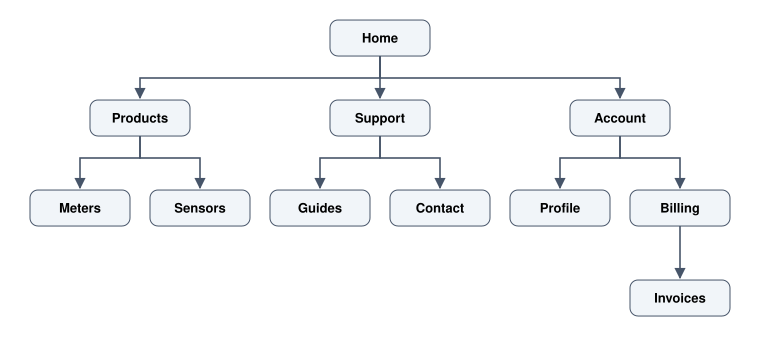
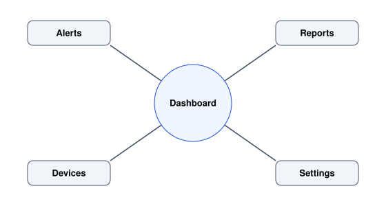
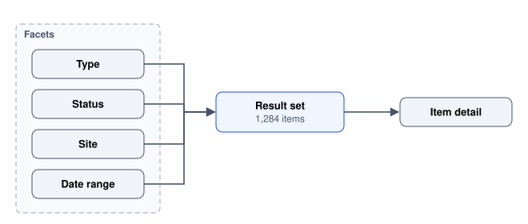

# Information Architecture

Structure, labels and navigation: making a large amount of content findable.

Author

Benedict Thekkel

Information architecture is the structural design of shared information: what things there are, how they group, what they are called, and how someone moves between them. It is invisible when it works. When it does not, the symptoms get misdiagnosed as visual problems, so teams restyle a navigation bar that is structurally wrong and the complaints continue.

Three questions define the whole discipline:

1.  **What is here?** (the content inventory)
2.  **How does it group?** (organisation and taxonomy)
3.  **What do we call it?** (labelling)

Navigation and search are how a user exercises the answers. They are the interface to the architecture, not the architecture itself, which is why adding a search box does not fix a broken structure. It just gives people a way around it.

The reason IA is hard is that it is a **social** problem, not a logical one. There is rarely one correct taxonomy. Engineering, sales and support each hold a different mental model of the same product, all three are internally consistent, and the site can only have one menu.

------------------------------------------------------------------------

## 1. Start with an inventory, not a diagram

Before structure comes a list of what exists. Everyone wants to skip this and draw boxes.

A content inventory is one row per page, screen or content type, with the things you will need to make decisions:

| Path | Title | Type | Owner | Last updated | Views / 90 days | Verdict |
|----|----|----|----|----|----|----|
| /billing/invoices | Invoices | List view | Finance | 2026-02 | 41,200 | Keep |
| /billing/statements | Statements | List view | Finance | 2024-06 | 89 | Merge into Invoices |
| /help/exporting-v2 | Exporting (new) | Article | Support | 2023-11 | 12 | Delete |

Two columns do most of the work. **Traffic** separates what people use from what the team talks about, which are very different lists. **Last updated** finds the orphans, and a page nobody has touched in two years is usually either wrong or unnecessary.

**Most restructures are mostly deletion.** An inventory typically finds that a third of the content is duplicated, obsolete or trivial. Removing it is faster than filing it and improves findability more than any menu change, because every extra item dilutes the scent of the ones that matter.

------------------------------------------------------------------------

## 2. Organisation schemes

How items group. There are only a few schemes, and the useful skill is recognising which one your content actually wants.

**Exact schemes** have one correct answer and no ambiguity. Alphabetical, chronological, geographic, numeric. Use them when the user already knows the item’s name or date. A country picker is alphabetical because that is a lookup, not a browse.

**Ambiguous schemes** require judgement and are where all the difficulty lives:

| Scheme | Groups by | Good when | Fails when |
|----|----|----|----|
| Topic | Subject matter | Users think in subjects | Items belong to several topics |
| Task | What you are doing | The verbs are distinct and few | Tasks span the same objects |
| Audience | Who you are | Roles are genuinely different and self-evident | People do not know which group they are in |
| Lifecycle | Stage in a process | The process is linear and shared | Users enter partway through |
| Metaphor | Likeness to something familiar | The metaphor is universal | It is your metaphor, not theirs |

**Audience-based schemes are the most commonly regretted.** “For developers / For businesses / For educators” forces a self-identification the visitor may get wrong, and a developer at a business now has two plausible doors and no way to know which holds the pricing. Use it only when the audiences need genuinely disjoint content.

**Organise by user vocabulary, not by internal structure.** The most reliable predictor of a bad menu is that it mirrors the org chart. Users do not know your departments and should not have to learn them to find a refund.

------------------------------------------------------------------------

## 3. Navigation models

Four shapes cover nearly everything. Most real products combine them.

**Hierarchy (tree).** One parent per item, breadth over depth. The default for content sites and settings.



Hierarchy tree with Home at the top and three children, Products (Meters, Sensors), Support (Guides, Contact) and Account (Profile, Billing), with Invoices one level below Billing.

**Prefer broad and shallow.** Each level down costs a decision and a page load, and both shed users. A rough working limit is three levels for a website and two for an app’s settings. The old “seven plus or minus two” rule is widely misapplied here: it was about short-term memory for recall, not about menu length. A scannable visible list of fifteen items is easier than five nested menus, because scanning is not remembering.

**Hub and spoke.** A central index, with each task a dead end that returns to the hub. The pattern of phone home screens and admin dashboards. Good when tasks are unrelated; frustrating when a user needs to move between two spokes repeatedly, because every move is a round trip through the hub.



Hub and spoke navigation: a central Dashboard connected separately to Alerts, Reports, Devices and Settings, with no links between the spokes.

**Faceted (filtered) browse.** No single hierarchy. Items carry many independent attributes and the user composes a view. Correct for e-commerce, media libraries, logs and any large set where different people slice differently.



Faceted browse: four independent facets, Type, Status, Site and Date range, all filter one result set of 1,284 items, which leads to an item detail page.

Facets are the honest answer to “this item belongs in three places”. Rules that make them work: show counts per facet value, never offer a filter that would return zero results, make active filters visible and individually removable, and keep the filtered state in the URL so it can be shared and bookmarked.

**Sequence (linear or wizard).** Forced order, one step at a time. Right for checkout, onboarding and anything with validation dependencies. Always show position and remaining length, allow going back without data loss, and resist the temptation to use it for anything the user might want to do out of order.

**Global, local, contextual.** Most products layer three navigation systems: global (persistent, on every screen), local (within the current section), and contextual (inline links, related items). Confusion usually comes from a local navigation that looks global, so the user cannot tell how far a click will take them.

------------------------------------------------------------------------

## 4. Labelling

Labels are where good structure most often dies. The structure is right, the words are the company’s, and nobody finds anything.

**Use the user’s words.** Source them from research transcripts, support tickets and site-search logs. Internal site-search queries are the single best label source you have, because they are literally people telling you what they call things after failing to find them.

| Internal label        | What users search for             |
|-----------------------|-----------------------------------|
| Consumption analytics | Usage, bills, how much did we use |
| Asset register        | Devices, meters, equipment        |
| Entity hierarchy      | Sites, locations                  |
| Remittance            | Payments, refunds                 |

**Specific beats clever.** “Resources” could hold anything. “Guides and templates” cannot be misunderstood. Every ambiguous label forces a click to disambiguate, and a wrong click costs the user their place.

**Be boringly consistent.** If it is “Devices” in the menu it is “Devices” in the page title, the breadcrumb, the empty state and the error message. A synonym introduced anywhere makes the reader wonder whether it is the same thing.

**Nouns for places, verbs for actions.** A navigation item is a destination, so it takes a noun. A button performs an action, so it takes a verb, and preferably the specific one: “Save changes” rather than “OK”, “Delete site” rather than “Confirm”.

**Beware the label that hides a decision.** “Settings” versus “Preferences” versus “Account” versus “Admin” in the same product means four places to look for one toggle. Pick one and collapse the rest.

------------------------------------------------------------------------

## 5. Card sorting

The standard method for learning how your users group things, run before you commit to a structure.

**Open sort.** Participants receive cards (one content item each) and create their own groups, then name them. Tells you both the grouping and the vocabulary. Use when the structure is undecided.

**Closed sort.** You supply the categories, participants file the cards into them. Tells you whether your proposed categories are understood. Use to validate a draft.

**Hybrid.** Your categories, plus permission to add their own. A good default: the added categories are often the most informative result.

**Practicalities.** 15 to 30 participants for quantitative confidence, or 5 to 8 if you mainly want to hear the reasoning aloud. Keep it to 30 to 60 cards, since beyond that fatigue dominates. Use the label a user would see on the card, not the internal name. Ask people to think aloud, because the hesitation is the finding: a card that gets picked up three times and moved twice is genuinely ambiguous and no analysis will show you that.

**Reading the results.** A similarity matrix shows which pairs of cards people put together, and a dendrogram clusters those agreements. What you are looking for is not a perfect tree but the places of high agreement (build on them) and the cards that land everywhere (these need to be reachable from several places, or their label is wrong).

------------------------------------------------------------------------

## 6. Tree testing

Card sorting asks people to build a structure. Tree testing asks whether they can *use* the one you built, and it is the more decisive of the two.

**How it works.** Strip the design away entirely and present the menu as indented text. Give a task in the user’s language (“you have been charged twice, find where you would ask for a refund”) and record the path they take.

Because there is no visual design, no search and no content, the result isolates structure and labels. This is exactly why it works: a beautiful page can carry a bad structure for a while, and tree testing removes that cover.

**What to measure.**

| Metric      | Meaning                                                     |
|-------------|-------------------------------------------------------------|
| Success     | Reached the correct destination                             |
| Directness  | Got there without backtracking                              |
| First click | Which top-level item they chose first                       |
| Time        | Secondary, but a long time with success still signals doubt |

**First-click accuracy is the number to watch.** Users who get the first click right succeed far more often than those who do not, so a task where first clicks scatter across three top-level items tells you the top level is wrong, no matter what the eventual success rate says.

Run it on the existing structure as a baseline, then on the proposal. A redesign that cannot beat the current tree on the same tasks is not an improvement, it is a change.

------------------------------------------------------------------------

## 7. Search

Search is not a substitute for structure, but for anything beyond a few hundred items it is how most people will actually navigate, and it is routinely under-designed.

**What a usable search needs.**

- **Tolerance for reality.** Misspellings, plurals, partial words, synonyms, and the internal jargon the organisation uses. Ship a synonym list and grow it from the query log.
- **Scoped search where scope is real.** Searching within a project, then offering to widen, beats one global box that returns everything.
- **Results that show why they matched.** Highlighted terms and a useful snippet, so a scan of the list is enough to choose.
- **Filters and sort on the result set.** Search then refine is the dominant behaviour on large sets.
- **A useful zero-results state.** Never a bare “no results”. Show what was searched, suggest a correction, drop the most restrictive filter automatically, and offer the browse entry points.
- **Persistence.** Keep the query in the URL and keep it in the box after the user returns from a result. Losing a typed query on a back navigation is one of the most annoying bugs in the category.

**Mine the query log continuously.** It is free, unsolicited, honest research. Queries with no results are a content backlog. High-volume queries are candidates for promotion into navigation. Queries using words your labels do not use are a labelling fix.

------------------------------------------------------------------------

## 8. URLs, breadcrumbs and knowing where you are

Three mechanisms that tell a user their position. On the web the URL is part of the interface whether you design it or not.

**URLs.** Readable, lowercase, hyphenated, hierarchical, and stable.

``` text
Good    /devices/meters/nmi-123/readings?from=2026-01-01
Bad     /app#/d/m?id=8842&v=2&tab=3
```

A good URL is guessable, editable by hand, comprehensible when pasted into a chat, and survives being bookmarked. **Never break one.** If structure changes, redirect permanently with a 301, because a dead bookmark is a user-visible failure with no recovery path. Keep filter and tab state in the URL so a view can be shared, which is worth more to real teams than almost any feature.

**Breadcrumbs.** Show the path from the root and make every ancestor clickable. Cheap, and they answer both “where am I” and “how do I get up a level” at once. Worth having whenever the hierarchy is more than two deep, and particularly valuable for people who arrived from a search engine directly into a leaf page.

**Current-location indication.** The active navigation item must look active, and it has to be signalled by something other than colour alone (see [Accessibility](../UI_UX/accessibility.llms.md)). A weight change, a marker, or an `aria-current="page"` attribute all carry the meaning where colour alone does not.

**Titles.** The page title is a wayfinding element too. `Invoices - Billing - Acme` reads correctly in a crowded tab bar, in a bookmark list and in a search result. Put the specific part first.

------------------------------------------------------------------------

## 9. How IA fails

- **The org chart as a menu.** Departments become top-level items and the user has to learn the company to find a page.
- **Depth used to look tidy.** A neat three-item menu hiding five levels is worse than a slightly untidy flat one. Users do not mind a long visible list; they mind guessing.
- **One item, many homes, no plan.** A page that legitimately belongs in three sections needs either facets or a canonical home plus cross-links. Duplicating it in three places splits its analytics and its maintenance, and the copies diverge.
- **Labels from the product team.** The single biggest cause of the failure users describe as “I could not find it”.
- **Search bolted on to absolve the structure.** It hides the problem from the team while users pay for it.
- **Adding a level to accommodate one new item.** Restructures happen once; the exceptions accumulate weekly, so agree a rule for where new things go or the tree rots.
- **No validation.** Card sorting and tree testing are both cheap, unmoderated, and able to be run in a couple of days. A structure shipped without either is a guess with a diagram.

------------------------------------------------------------------------

## Where this goes next

Structure decides where things live. The next questions are about what happens when someone acts:

- [Interaction Design](../UI_UX/interaction_design.llms.md) covers flows, states and feedback within a screen.
- [Content Design and Motion](../UI_UX/content_design_and_motion.llms.md) goes deeper on the wording that labels depend on.
- [Usability Evaluation](../UI_UX/usability_evaluation.llms.md) covers the testing that validates a structure once it has a design on it.
- [UX Research](../UI_UX/ux_research.llms.md) supplies the vocabulary and mental models this notebook assumes you have collected.

For the implementation side, [HTML](../html.llms.md) covers the semantic elements that express navigation structure to browsers and assistive technology, and [SEO](../SEO/seo.llms.md) covers how the same structure is read by search engines.

------------------------------------------------------------------------

Back to top
