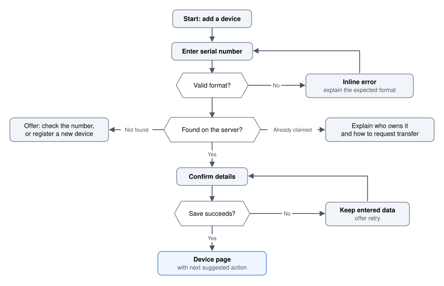
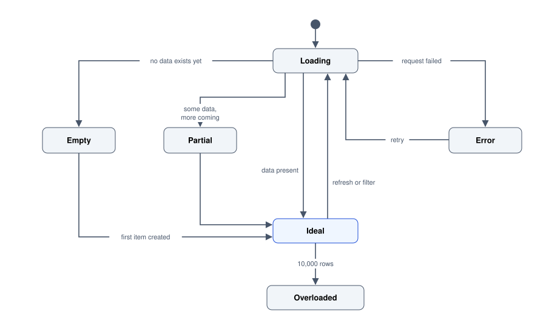
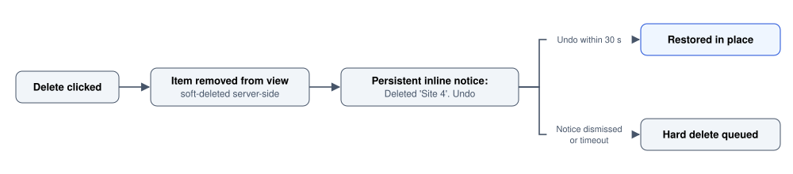

# Interaction Design

Flows, states, affordances and feedback: what happens when someone actually uses the thing.

Author

Benedict Thekkel

Interaction design is the behaviour of an interface over time. Visual design decides what a screen looks like; interaction design decides what it does, what it looked like a moment ago, and what it will do if the network drops halfway through.

The output is not a picture. It is a set of answers to:

- What can I do here, and how do I know?
- What happened after I did it?
- What state is the system in now?
- How do I undo it?

Most interface defects are failures of one of those four. A button that is not recognisably a button, an action with no feedback, a screen that shows stale data, a destructive operation with no way back. None of these are visual problems, and restyling will not fix any of them.

------------------------------------------------------------------------

## 1. Flows before screens

Start with the path, not the page. A flow shows decisions and dead ends, which is where the design work actually is.



Add-device flow: enter a serial number; an invalid format shows an inline error and returns to entry; a lookup that finds nothing offers to check the number or register a new device, and an already claimed device explains the owner and how to request transfer; a found device goes to confirm details, where a failed save keeps the data and offers retry, and a successful save opens the device page with a next suggested action.

Notice that the happy path is four boxes and the rest of the diagram is failure. That ratio is normal and it is the point of drawing it: a design reviewed only on its happy path will ship with three unhandled dead ends, and those dead ends are where people abandon and contact support.

**Draw the flow before any visual work.** It is cheap to move a decision on a diagram and expensive to move it once six screens exist.

------------------------------------------------------------------------

## 2. Every screen has states, not one state

The most common gap between a design and a shipped product is that the design shows the screen full of plausible data and nothing else. Real screens spend meaningful time in other states.



State diagram of a screen: it starts in Loading, which goes to Empty when no data exists yet, Partial when more data is coming, Error when the request fails, or Ideal when data is present; Partial and Empty (after the first item is created) move to Ideal, Error retries back to Loading, Ideal returns to Loading on refresh or filter, and Ideal becomes Overloaded at 10,000 rows.

Design all of these explicitly:

| State | What it must do | Common failure |
|----|----|----|
| **Empty (first run)** | Explain what goes here, why it is useful, and give the action that fills it | A blank panel, or “No data” with no next step |
| **Empty (filtered to nothing)** | Say which filter excluded everything and offer to clear it | Indistinguishable from first-run empty, so the user thinks their data is gone |
| **Loading** | Indicate progress; preserve layout to avoid a jump | A spinner that replaces the whole page on every keystroke |
| **Partial** | Show what arrived, mark what has not | All-or-nothing blocking on the slowest widget |
| **Error** | Say what failed, whether it was retryable, and what to do; keep the user’s input | A toast that disappears, wording aimed at developers, lost form data |
| **Ideal** | The state in the mockup | Only this one gets designed |
| **Overloaded** | Paginate, virtualise, aggregate; keep controls reachable | A table that grows until the browser stalls |
| **Offline / stale** | Say the data is old and when it was fetched | Silently showing stale numbers as if live |

**The empty state is the highest-leverage screen in most products** and gets the least attention. It is the first thing a new user sees, so it is onboarding whether you designed it as onboarding or not.

**Stale data deserves specific mention.** A dashboard that cannot reach the server and keeps displaying the last numbers it had, with no indication, is not a degraded experience. It is a wrong one, and someone will make a decision on it.

------------------------------------------------------------------------

## 3. Affordances and signifiers

Donald Norman’s distinction, and worth keeping straight because the words get used loosely.

- An **affordance** is a possible action given the object and the actor. A link can be clicked. A list can be scrolled.
- A **signifier** is the perceivable signal that tells you the affordance exists. Underlined blue text. A raised edge. A scrollbar. A cursor change.

Software has no physical affordances at all, so **every affordance in an interface is entirely signified**. If the signifier is missing, the capability might as well not exist.

This is the actual cost of the flat-design era: removing borders, shadows and underlines removed signifiers, and a decade of research followed showing that users click fewer things when the things do not look clickable. The correct reading is not that flat design is wrong, it is that *something* has to carry the signal.

**Practical rules.**

- **Make interactive things look interactive and non-interactive things not.** A card with a shadow that is not clickable is as bad as a button with none.
- **Keep link underlines in body text.** Colour alone fails for colour-blind readers and for anyone scanning.
- **Give every interactive element four visible states**: rest, hover, focus, active, plus disabled where it applies. Hover is mouse-only, so focus is the one that must never be removed (see [Accessibility](../UI_UX/accessibility.llms.md)).
- **Do not invent gestures without a visible alternative.** A swipe-to-archive with no button is a feature most users never discover.

``` css
/* Four states, and a focus ring that survives a redesign. */
.btn            { background: var(--accent); color: #fff; border: 1px solid transparent; }
.btn:hover      { background: var(--accent-hover); }
.btn:focus-visible { outline: 2px solid var(--focus); outline-offset: 2px; }
.btn:active     { transform: translateY(1px); }
.btn[disabled]  { opacity: .5; cursor: not-allowed; }
```

------------------------------------------------------------------------

## 4. Feedback and system status

Every action needs an acknowledgement, and the form of it depends on how long the action takes. These thresholds come from Jakob Nielsen’s response-time limits and have held up for decades because they are about human perception rather than technology.

| Delay | Perceived as | What the interface owes the user |
|----|----|----|
| Under 0.1 s | Instantaneous | Nothing; just do it |
| Up to 1 s | A slight pause | Nothing, but do not break the flow of thought |
| 1 to 10 s | Waiting | An indicator; keep attention with progress |
| Over 10 s | Long enough to leave | Percentage progress, an estimate, and a way to do something else |

**Choose the indicator honestly.**

- **Spinner** for an unknown short wait. A spinner for 30 seconds is torture because it carries no information.
- **Determinate progress bar** whenever you can compute a fraction. A bar that stalls at 99 percent destroys trust in every future bar you show.
- **Skeleton placeholders** when you know the shape of the incoming content. They prevent layout shift and make the wait feel shorter because the page appears to be assembling.
- **Optimistic update** when failure is rare and reversible: apply the change immediately, reconcile in the background, and roll back visibly with an explanation if it fails. Correct for a like button, wrong for a payment.

**Where feedback belongs.** Put it next to the thing that changed. A toast in the corner is the weakest form of feedback available: it is easy to miss, it disappears before a slow reader finishes, and it is invisible to someone using a screen magnifier on another part of the page. Use inline confirmation for inline changes, and reserve toasts for genuinely incidental notices.

**Announce changes to assistive technology.** A visual-only update is invisible to a screen reader user, so dynamic regions need `aria-live` (`polite` for status, `assertive` only for genuine interruptions).

------------------------------------------------------------------------

## 5. Forms

Forms are where interaction design meets people’s patience most directly.

**Structure.**

- **One column.** Multi-column forms cause fields to be skipped, and they reflow badly on narrow screens. The exception is genuinely paired data such as city and postcode.
- **Labels above fields, always visible.** Placeholder-as-label is the most persistent bad pattern in web forms: the label vanishes as soon as typing starts, so it cannot be checked, it fails low-contrast requirements, and it breaks autofill.
- **Group related fields** with `fieldset` and `legend`, which is both a visual and an assistive-technology grouping.
- **Ask for less.** Every field costs completion. If a field is not used, delete it rather than making it optional.
- **Mark optional fields rather than required ones** when most are required.

**Input behaviour.**

- Set the right keyboard and autofill on mobile: `type="email"`, `inputmode="numeric"`, `autocomplete="one-time-code"`.
- Never split a phone number, card number or code into several boxes. Accept one field and normalise spacing yourself.
- Do not block paste. Blocking paste in a password field actively prevents password-manager use, which makes security worse.
- Preserve everything the user typed across a failed submit, a back navigation, and a session timeout.

**Validation timing.** The rule that resolves most arguments: **validate a field on blur, not on every keystroke, and never show an error for a field the user has not finished.** Telling somebody their email is invalid after they have typed two characters is both wrong and hostile. Re-validate on input only once the field is already in an error state, so the error clears as soon as it is fixed.

**Error messages.** Beside the field, in text, describing what to do. Colour and an icon in addition, never instead.

``` html
<label for="nmi">NMI</label>
<input id="nmi" name="nmi" inputmode="numeric" autocomplete="off"
       aria-describedby="nmi-hint nmi-err" aria-invalid="true">
<p id="nmi-hint">10 or 11 digits, printed on the meter.</p>
<p id="nmi-err" role="alert">This NMI is 9 digits. Check for a missing leading zero.</p>
```

``` text
Bad     Invalid input.
Bad     Error: field validation failed (code 422).
Better  Enter a date on or after 1 July 2026. Your billing period starts then.
```

------------------------------------------------------------------------

## 6. Progressive disclosure

Show what is needed now; make the rest reachable. This is how an interface serves a beginner and an expert without becoming two products.

| Mechanism | Use for |
|----|----|
| Sensible defaults | The 80 percent case, so most users never open the advanced panel at all |
| Collapsed “Advanced” section | Real but rare options |
| Inline expansion | Detail about the thing in front of you |
| Drawer or side panel | Detail you need while keeping the list in view |
| Separate page | A task substantial enough to deserve its own URL |
| Tooltip or popover | A short definition, never anything essential |

**Defaults are the most powerful tool here.** Most people never change a default, so a default is a design decision about what will actually happen, not a suggestion. Choose the safe option, not the profitable one.

**Rules that keep it honest.**

- **Nothing required may be hidden.** If a task cannot be completed without opening the advanced panel, the panel is not advanced.
- **Say what is inside.** “Advanced” tells the user nothing; “Retry and timeout settings” lets them decide whether to look.
- **Do not hide behind hover.** Hover does not exist on touch and is awkward with a keyboard. Anything revealed on hover needs a click or focus path too.
- **Remember the disclosure state** within a session. Reopening the same panel on every visit is a small, constant insult to a power user.

------------------------------------------------------------------------

## 7. Destructive actions, undo and confirmation

The default reflex is a confirmation dialog. It is usually the weaker option.

**Undo beats confirmation.** A confirmation interrupts every action, including the thousands of correct ones, and people learn to dismiss it without reading, which means it stops protecting them at exactly the moment it matters. Undo costs nothing on the correct path and fully recovers the incorrect one.



Undo instead of confirmation: clicking delete removes the item from view and soft-deletes it on the server, a persistent inline notice offers Undo, undo within 30 seconds restores the item in place, and dismissing the notice or timing out queues the hard delete.

**Use a confirmation only when undo is genuinely impossible**: sending an email or a payment, destroying another party’s data, an irreversible export. When you do:

- **Describe the consequence, not the mechanics.** “Delete Site 4 and its 18 months of readings? This cannot be undone.”
- **Label the buttons with the actions.** “Delete site” and “Keep site”, never “OK” and “Cancel”, so a glance is enough.
- **Make the destructive button the non-default one**, and require typing the name for genuinely catastrophic operations.
- **One confirmation per action.** Chained dialogs are trained through blindly.

**Also.** Always offer bulk undo for bulk operations; separate “archive” from “delete” because most requests for deletion are really requests to get something out of the way; and never put a destructive action adjacent to a common one in a row of icon buttons.

------------------------------------------------------------------------

## 8. Laws worth knowing

Shorthand for effects that repeatedly show up in usability data. They are heuristics, not physics, and each is most useful as a question to ask of a design.

| Law | Statement | What it changes in practice |
|----|----|----|
| **Fitts’s law** | Time to hit a target grows with distance and shrinks with target size | Make frequent controls big and near the pointer or thumb. Screen edges and corners are effectively infinite depth, which is why the OS menu bar lives there |
| **Hick’s law** | Decision time grows with the number of choices | Fewer visible options, or group them. A 40-item flat menu is slower than 5 groups of 8 |
| **Miller’s law** | Working memory holds about 4 chunks, not 7 | Do not make people carry a value between screens. Chunk long numbers |
| **Jakob’s law** | People expect your site to work like the others they know | Convention beats novelty for anything not core to your value. Put the cart at the top right |
| **Doherty threshold** | Productivity rises sharply when response is under 400 ms | Perceived performance is a design concern, not only an engineering one |
| **Tesler’s law** | Complexity is conserved: it moves between system and user | Every simplification pushes work somewhere. Decide deliberately whether the system or the person absorbs it |
| **Peak-end rule** | An experience is remembered by its peak and its end | Invest in the worst moment and the final moment of a flow |
| **Goal-gradient effect** | Effort rises as a goal gets closer | Show progress, and pre-fill the first step so the bar is never at zero |

**Touch targets are Fitts’s law made concrete.** WCAG 2.2 asks for at least 24 by 24 CSS pixels, Apple recommends 44 by 44 points, and Google recommends 48 by 48 dp. Use 44 to 48 as the working minimum for anything finger-operated, keep at least 8 pixels between adjacent targets, and note that the *target* can be larger than the visible icon.

------------------------------------------------------------------------

## 9. Nielsen’s ten heuristics

The 1994 list, still the standard checklist for a fast expert review. Each line below is the heuristic plus what it looks like when violated.

| \# | Heuristic | Violation looks like |
|----|----|----|
| 1 | **Visibility of system status** | No indication whether a save happened |
| 2 | **Match the real world** | Internal jargon in the menu; “entity” for what users call a site |
| 3 | **User control and freedom** | No undo, no cancel, a wizard that cannot go back |
| 4 | **Consistency and standards** | Three different date formats; the primary button on the left here and the right there |
| 5 | **Error prevention** | A free-text date field instead of a picker with a valid range |
| 6 | **Recognition over recall** | Requiring a code copied from a previous screen |
| 7 | **Flexibility and efficiency** | No keyboard shortcuts, no bulk actions, no saved views |
| 8 | **Aesthetic and minimalist design** | Six competing calls to action, so none reads as primary |
| 9 | **Help users recover from errors** | “An error occurred.” No cause, no fix, no retry |
| 10 | **Help and documentation** | Help that explains the menu rather than the task |

Number 4 deserves emphasis because it is the one teams trade away most casually. **Consistency is a performance feature, not a tidiness preference.** Every inconsistency is a small relearning cost, paid repeatedly, by everyone.

How to use the list: walk a real task, and at each screen name the number of any heuristic being broken. Ten minutes of this finds more than an hour of unstructured opinion. The full method is in [Usability Evaluation](../UI_UX/usability_evaluation.llms.md).

------------------------------------------------------------------------

## 10. How interaction design fails

- **Only the ideal state exists.** The single most common and most expensive gap. See section 2.
- **Actions without acknowledgement.** The user clicks again, and now there are two invoices.
- **Errors that blame the user and lose their work.** A failed submit that clears the form is a defect, not an inconvenience.
- **Hover-only affordances.** Invisible on touch, unreachable by keyboard, undiscoverable by everyone.
- **Focus removed for looks.** `outline: none` with nothing in its place makes the product unusable by keyboard. It is the most common accessibility failure in shipped code.
- **Modals over modals.** A dialog that opens a dialog has nowhere to go and traps focus in the wrong place.
- **Confirmation used as a substitute for design.** Covered in section 7.
- **Novelty in the load-bearing parts.** A custom scroll behaviour or a reinvented select control costs users their existing knowledge and almost never pays it back.
- **Optimistic updates without a rollback path.** The change appears to work, fails silently server-side, and the user finds out later.

------------------------------------------------------------------------

## Where this goes next

- [Visual Design Foundations](../UI_UX/visual_design_foundations.llms.md) covers the layout, type and colour that make these states legible.
- [Design Systems and Tokens](../UI_UX/design_systems_and_tokens.llms.md) is how the four interactive states and their tokens stay consistent across a product.
- [Accessibility](../UI_UX/accessibility.llms.md) covers focus order, `aria-live`, target sizes and the keyboard paths this notebook keeps referring to.
- [Content Design and Motion](../UI_UX/content_design_and_motion.llms.md) covers the wording of the errors and empty states above, and the animation that makes a transition comprehensible.
- [Usability Evaluation](../UI_UX/usability_evaluation.llms.md) is how you find out whether any of it worked.

On the implementation side see [HTML](../html.llms.md) for native form controls and semantics, [CSS](../css.llms.md) for the state styling, and [React Overview](../React/react_overview.llms.md) for managing these states in components.

------------------------------------------------------------------------

Back to top
