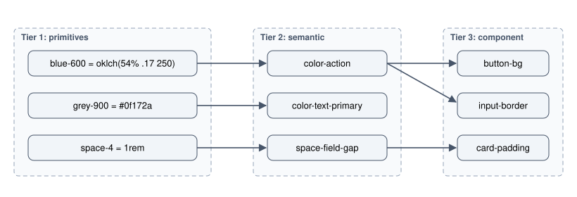
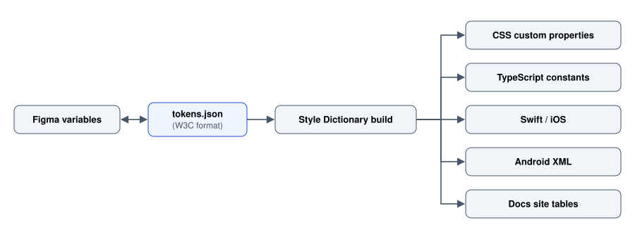

# Design Systems and Tokens

Turning one-off decisions into named, versioned, reusable values and components.

Author

Benedict Thekkel

A design system is the set of decisions a product has already made, written down in a form both designers and code can use. Its purpose is not consistency for its own sake. It is to stop a team re-deciding the same things, differently, every sprint.

Three terms get used interchangeably and are not the same thing:

| Thing | What it is | Lives as |
|----|----|----|
| **Style guide** | Documentation of visual rules. Read by humans | A page, a PDF |
| **Component library** | Implemented, reusable components | An npm package, a Figma library |
| **Design system** | Tokens, components, patterns, usage guidance, plus the process that maintains them | All of the above, versioned, with owners |

**The part that most often gets skipped is the last clause.** A component library with no owner, no versioning and no decision process is not a design system, it is a folder. It will drift, teams will fork it, and within a year there will be three buttons again.

This notebook covers tokens (the values), components (the assembled units), and governance (what keeps them true). The raw material, meaning the scales and the colour theory, is in [Visual Design Foundations](../UI_UX/visual_design_foundations.llms.md).

------------------------------------------------------------------------

## 1. Tokens: the three tiers

A design token is a named design decision. The value of naming it is not brevity, it is indirection: you can change what a name points at without hunting through code.

The architecture that survives contact with reality has three tiers.



Three token tiers from left to right: primitives blue-600, grey-900 and space-4 feed the semantic tokens color-action, color-text-primary and space-field-gap, and color-action feeds the component tokens button-bg and input-border while space-field-gap feeds card-padding.

**Tier 1, primitives.** The raw palette and scales. Names describe the value: `blue-600`, `space-4`, `text-lg`, `radius-md`. No meaning attached, so they are safe to define once and rarely change.

**Tier 2, semantic.** Names describe the *job*: `color-action`, `color-text-secondary`, `color-border-subtle`, `color-danger`, `space-section-gap`. **This tier is the one that earns the whole system**, because it is where theming happens and where intent is recorded. `color-action` can be rebranded from blue to green by editing one line.

**Tier 3, component.** Optional, and only worth adding for components that need to vary independently: `button-primary-bg`, `input-border-rest`. Skip this tier until a real need appears, or you will maintain hundreds of aliases that all point straight through.

**The rule that makes tokens work: application code references tier 2, never tier 1.** The moment a component uses `blue-600` directly, it has opted out of theming and nobody will notice until dark mode ships.

``` css
/* Tier 1: primitives */
:root {
  --blue-500: oklch(62% .16 250);
  --blue-600: oklch(54% .17 250);
  --grey-50:  oklch(98% .005 250);
  --grey-500: oklch(60% .02 250);
  --grey-900: oklch(22% .02 250);
  --red-600:  oklch(55% .19 25);
}

/* Tier 2: semantic. The only tier components are allowed to use. */
:root {
  --color-surface:        var(--grey-50);
  --color-text-primary:   var(--grey-900);
  --color-text-secondary: var(--grey-500);
  --color-action:         var(--blue-600);
  --color-action-hover:   var(--blue-500);
  --color-danger:         var(--red-600);
  --color-border-subtle:  oklch(90% .01 250);
  --focus-ring:           var(--blue-500);
}

/* Component: consumes tier 2 only */
.btn-primary {
  background: var(--color-action);
  color: var(--color-on-action);
  padding: var(--space-2) var(--space-4);
  border-radius: var(--radius-md);
}
.btn-primary:hover { background: var(--color-action-hover); }
```

------------------------------------------------------------------------

## 2. Naming

Naming is most of the difficulty, and a bad scheme is expensive to correct once a hundred components consume it.

**Use a consistent ordered pattern.** A common one is `category-concept-property-variant-state`, applied loosely but predictably:

``` text
color-text-primary
color-text-primary-inverse
color-bg-surface-raised
color-border-input-error
space-inline-sm
radius-control
shadow-overlay
```

**Name by role, never by appearance.** This is the single most important naming rule and the one most often broken:

| Do not | Do | Why |
|----|----|----|
| `color-blue-button` | `color-action` | The brand will change colour; the role will not |
| `color-grey-light` | `color-border-subtle` | “Light” is wrong in dark mode |
| `space-16` used semantically | `space-section-gap` | Encodes the decision, not the number |
| `text-small-grey` | `color-text-secondary` | Two properties fused into one name |

The dark mode test settles any naming argument: **if a token name becomes false when the theme flips, the name describes appearance rather than role.** `color-grey-light` is a lie in a dark theme. `color-border-subtle` stays true.

**Other conventions worth fixing early.** Pick one word per concept and never its synonyms (`bg` or `background`, not both). Use `-inverse` for text on a coloured ground, and `on-` prefixes if you prefer the Material convention (`color-on-action`). Keep abbreviations to a tiny agreed list. And write the name in one casing in the source of truth, letting the build emit whatever each platform wants.

------------------------------------------------------------------------

## 3. One source of truth, many outputs

Tokens are most useful when the same values reach CSS, iOS, Android, Figma and documentation without anyone retyping them. The usual arrangement is a platform-neutral file, conventionally JSON, and a build step.

``` json
{
  "color": {
    "action": {
      "$value": "{color.blue.600}",
      "$type": "color",
      "$description": "Primary action: filled buttons, active nav, links"
    }
  },
  "space": {
    "field-gap": { "$value": "{space.4}", "$type": "dimension" }
  }
}
```

That shape is the **W3C Design Tokens** community format (`$value`, `$type`, `$description`, with `{}` references), which is worth adopting because tooling is converging on it. Style Dictionary and Tokens Studio both read and write it.



Token build pipeline: tokens.json in W3C format syncs both ways with Figma variables and feeds a Style Dictionary build, which outputs CSS custom properties, TypeScript constants, Swift for iOS, Android XML and docs site tables.

**Keep the pipeline one-directional if you can.** Two-way sync between Figma and a repository sounds appealing and produces merge conflicts nobody knows how to resolve. Pick which side is authoritative, and it is usually the repository, because that is the one with review, history and CI.

**The value of the build step is enforcement.** A token that exists in Figma and not in CSS is where drift starts. Generating both from one file makes drift a build failure rather than a slow divergence.

------------------------------------------------------------------------

## 4. Theming

If tier 2 is doing its job, a theme is a table of overrides and nothing else.

``` css
/* Light is the default, defined on bare :root so it is never conditional */
:root {
  --color-surface: var(--grey-50);
  --color-surface-raised: #fff;
  --color-text-primary: var(--grey-900);
  --color-border-subtle: oklch(90% .01 250);
  --color-action: var(--blue-600);
  --shadow-overlay: 0 8px 24px rgb(0 0 0 / .12);
}

/* System preference, but never override an explicit light choice */
@media (prefers-color-scheme: dark) {
  :root:not([data-theme="light"]) {
    --color-surface: oklch(18% .015 250);
    --color-surface-raised: oklch(23% .015 250);   /* depth by lightness, not shadow */
    --color-text-primary: oklch(95% .01 250);
    --color-border-subtle: oklch(32% .015 250);
    --color-action: oklch(70% .13 250);            /* desaturated: saturated blues vibrate on dark */
    --shadow-overlay: 0 8px 24px rgb(0 0 0 / .5);
  }
}

/* Explicit choice wins in both directions */
:root[data-theme="dark"] { /* same dark block */ }
```

**Three states, not two.** Light, dark, and “follow the system”, which is the default. A toggle that only flips a class cannot express the third, so store the preference as `light`, `dark` or `system` and only stamp an attribute for the first two.

**What changes in dark mode beyond swapping greys:**

- **Desaturate accents.** A colour that reads correctly on white glows unpleasantly on near-black.
- **Avoid pure black and pure white.** `#000` with `#fff` text causes halation, where the text appears to bleed. Use a very dark grey with a slightly dimmed white.
- **Elevation inverts.** Raised surfaces get *lighter*, because a dark shadow on a dark ground is invisible.
- **Images and illustrations need attention.** A screenshot with a white background becomes a glowing rectangle. Consider a `filter` for line art, or ship two assets.
- **Re-check contrast.** Passing in light says nothing about dark; the ratios are independent.

**Never define a colour only inside a media query.** If the light value lives in `@media (prefers-color-scheme: light)` and a user has no preference set, the token is undefined. Bare `:root` carries the default; the media query only overrides.

------------------------------------------------------------------------

## 5. Components

Tokens make values consistent. Components make behaviour consistent, which is the harder half.

**Design the API, not just the appearance.** A component’s props are its contract and are as much a design decision as its padding.

``` tsx
// Constrained variants beat open styling props.
type ButtonProps = {
  variant?: 'primary' | 'secondary' | 'ghost' | 'danger';
  size?: 'sm' | 'md' | 'lg';
  loading?: boolean;
  disabled?: boolean;
  iconStart?: ReactNode;
  children: ReactNode;          // the label; never optional for an icon-only case
};
```

**Rules that keep a component library usable.**

- **Enumerate variants; do not accept arbitrary styles.** A `color` prop taking any string means the system no longer knows what exists. Adding a variant should be a deliberate, reviewed act.
- **Do not leak layout.** A component should not set its own outer margin, because the parent owns spacing. This one rule prevents a large share of “why is there a gap here” bugs.
- **Handle every state in the component**, including loading, disabled, error and focus, so consumers cannot forget them. A `loading` prop that also disables the button and preserves its width is a small thing that prevents layout jump everywhere it is used.
- **Accessibility belongs inside.** Focus ring, `aria-*`, roles, keyboard handling and the accessible name requirement live in the component, so that correctness is the default rather than a per-use effort. This is the strongest practical argument for a component library at all.
- **Provide an escape hatch, and watch it.** A `className` passthrough is pragmatic, but heavy use of it is the signal that the system is missing something real.

**Anatomy documentation matters.** For each component record its parts, its variants, its states, when to use it, and explicitly **when not to** with a pointer to the right alternative. The “when not to” section is what stops a tab bar being used for navigation between pages.

**Consider headless primitives for complex controls.** Combobox, dialog, menu, date picker and tooltip are each deceptively hard to get right for keyboard and screen reader use. Libraries such as Radix, React Aria or Headless UI supply behaviour and accessibility while leaving styling to your tokens. Building these from scratch is a recognised way to ship an inaccessible product.

------------------------------------------------------------------------

## 6. Governance and versioning

This is the part that decides whether the system is alive in two years.

**Name owners.** A system with no owner becomes a system nobody trusts. That does not require a dedicated team: a rotating maintainer plus a review requirement works for a small product.

**Decide how a change gets in.** A lightweight, written path: propose, discuss, accept or reject with a recorded reason. The rejections matter as much as the additions, because a system that accepts everything becomes a catalogue rather than a set of decisions.

**Version it properly.** Semantic versioning, applied to design as well as code:

| Change | Bump | Example |
|----|----|----|
| Fix within the contract | patch | Correcting a focus ring offset |
| Additive, backwards compatible | minor | A new `ghost` button variant |
| Breaking | major | Renaming a token, removing a variant, changing default spacing |

**Renaming a token is a breaking change.** It is tempting to treat design values as cosmetic, but a renamed token breaks every consumer. Deprecate with an alias, announce, then remove in a major release.

**Adoption is measurable, so measure it.** Count the proportion of components in the product that come from the system, and count the hard-coded colour and spacing values that bypass tokens. A linter can enforce the second one:

``` js
// stylelint: forbid raw colours so tokens stay the only route
rules: {
  'declaration-property-value-disallowed-list': {
    'color': ['/^#/', '/^rgb/'],
    'background-color': ['/^#/', '/^rgb/'],
  },
}
```

**Support the consumers.** A changelog, a migration note per breaking change, and a place to ask questions. Most design systems fail through friction rather than technical deficiency: if using the system is slower than writing the CSS by hand, people will write the CSS by hand and be right to.

------------------------------------------------------------------------

## 7. When not to build one

A design system has a real and continuing cost. It is frequently the wrong investment.

**Do not build one when:**

- **The product is still finding its shape.** Systematising decisions you are about to discard slows you down twice.
- **There is one product, one designer and one developer.** A shared stylesheet and a token file is the whole system you need, and it is enough.
- **Nobody will own it.** An unowned system is worse than none, because it looks authoritative while being wrong.
- **An existing system would do.** Adopting Material, Carbon, Fluent, shadcn/ui or Bootstrap and theming it through tokens is a legitimate and often better answer than building from zero. You inherit the accessibility work, which is the expensive part.

**The honest minimum, and it covers a surprising number of projects:** a token file, a documented type and spacing scale, and half a dozen components that carry their own accessibility. Start there and grow only on evidence of repeated duplication.

**The signals that you have outgrown the minimum:** three different buttons in the product, two teams disagreeing about spacing in review, a rebrand that requires touching hundreds of files, or a second platform arriving.

------------------------------------------------------------------------

## 8. Systems worth reading

Existing systems are free, thoroughly documented design research. Read them for the reasoning, not to copy their look.

| System | Owner | Worth it for |
|----|----|----|
| **Material Design 3** | Google | The most complete token taxonomy and colour-role model anywhere; dynamic colour |
| **Human Interface Guidelines** | Apple | Platform conventions, touch target sizing, restraint |
| **Carbon** | IBM | Enterprise data density, tables, and an unusually good accessibility section |
| **Fluent 2** | Microsoft | Cross-platform tokens and a well-argued layering model |
| **Polaris** | Shopify | Content and tone guidance integrated with components, which most systems separate |
| **Atlassian Design System** | Atlassian | Practical component documentation and clear do/do-not examples |
| **GOV.UK Design System** | UK government | The best-evidenced patterns in existence, each with published research; accessibility-first |
| **Primer** | GitHub | A real system evolving under a large legacy product |
| **shadcn/ui** | Community | The copy-into-your-repo model: Radix behaviour plus Tailwind tokens, owned by you |

**GOV.UK deserves particular attention** if you only read one. Every pattern cites the user research behind it, including patterns they tried and abandoned, which is rare and more instructive than a finished specification.

**Note the trade-off in the shadcn model.** Copying components into your repository gives full ownership and no version upgrades, which is excellent until a fix lands upstream and you have to port it yourself.

------------------------------------------------------------------------

## 9. How design systems fail

- **Built as a component catalogue with no usage guidance.** Teams then use the wrong component correctly.
- **Tokens named for appearance**, so the first theme change invalidates half the names.
- **Components consuming tier 1 directly**, which silently opts them out of theming.
- **No owner.** Drift, forks, three buttons.
- **Adoption assumed rather than measured.** The system exists, the product does not use it, and nobody knows because nobody counted.
- **Too rigid too early.** A system with no escape hatch gets bypassed entirely, which is worse than a system with a monitored one.
- **Figma and code out of sync**, so neither is trusted and every ticket starts with a question about which is right.
- **Accessibility left to consumers.** The single biggest missed opportunity: a component library is the one place where fixing focus handling once fixes it everywhere.
- **Documentation that describes the component rather than the decision.** A page showing four button variants without saying when to use each is a screenshot, not documentation.
- **A rebrand that turns out to require code changes everywhere**, which is the proof that the token indirection was never really in place.

------------------------------------------------------------------------

## Where this goes next

- [Visual Design Foundations](../UI_UX/visual_design_foundations.llms.md) is the source of the scales and colour reasoning that tokens formalise.
- [Responsive and Multiplatform](../UI_UX/responsive_and_multiplatform.llms.md) covers tokens that vary by viewport and by platform.
- [Accessibility](../UI_UX/accessibility.llms.md) is what components should be enforcing on behalf of their consumers.
- [Prototyping and Handoff](../UI_UX/prototyping_and_handoff.llms.md) covers Figma components and variables, the design-side half of everything here.

On the implementation side: [CSS](../css.llms.md) for custom properties, [Bootstrap](../bootstrap.llms.md) for an existing themeable system, [React Overview](../React/react_overview.llms.md) and [React Libraries](../React/react_libraries.llms.md) for component composition, and [npm](../npm.llms.md) for publishing and versioning the package itself.

------------------------------------------------------------------------

Back to top
