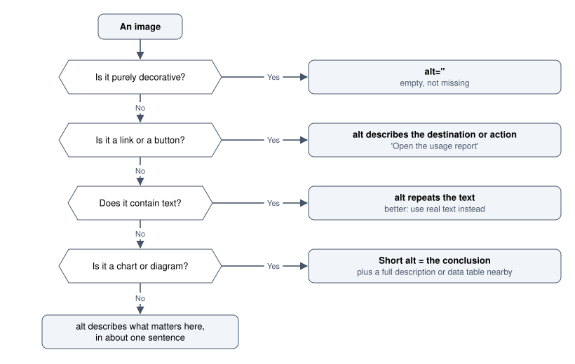

# Accessibility

WCAG, semantics, keyboard operation and assistive technology: making the interface usable by everyone.

Author

Benedict Thekkel

Accessibility is the practice of making an interface usable by people whose abilities, devices or circumstances differ from the designer’s. It is not a minority concern. Roughly one in six people lives with a significant disability, and the categories overlap with everyone else: a broken wrist is a temporary motor impairment, bright sunlight is a temporary vision impairment, and holding a child is a temporary one-handed input mode.

**The most useful reframing is that accessibility work is mostly just correctness.** A focus ring, a label, a sensible tab order and a contrast ratio are all things a careful implementation gets right anyway. The vast majority of real-world failures are not exotic, they are missing labels, missing focus states, low contrast, and `div`s used as buttons.

**Retrofitting is the expensive path.** Deciding on a colour palette that fails contrast, then discovering it after building fifty screens, means rebuilding the palette and every screenshot. The same decision made on day one costs nothing. This is the single strongest argument for treating accessibility as a design constraint rather than a QA phase.

------------------------------------------------------------------------

## 1. Standards, levels and obligations

**WCAG** (Web Content Accessibility Guidelines) is the reference standard, published by the W3C. Version 2.2 is current, with 2.1 still widely cited in legislation.

Each success criterion is graded:

| Level | Meaning | In practice |
|----|----|----|
| **A** | Minimum. Failing these blocks people entirely | Never optional |
| **AA** | The conformance target essentially every policy and contract names | **The level to design and build to** |
| **AAA** | Enhanced. Not expected for a whole site | Adopt individual criteria where cheap |

**AA is the working target.** Statements like “WCAG 2.1 AA” or “WCAG 2.2 AA” appear in procurement documents, government requirements and accessibility policies worldwide. AAA includes criteria such as 7:1 contrast and sign-language interpretation, which are not realistic as a blanket goal.

**Legal context varies by jurisdiction** and changes, so treat this as orientation rather than advice: many countries reference WCAG AA in public-sector procurement, the European Accessibility Act applies to a range of private products, and in Australia the Disability Discrimination Act has been applied to websites. The practical summary is that AA is both the ethical and the commercial floor.

**Accessibility conformance is not a certificate you earn once.** Every release can regress it, which is why automated checks belong in CI and manual checks belong in the definition of done.

------------------------------------------------------------------------

## 2. POUR: the four principles

WCAG organises everything under four headings, and they are a genuinely useful mental checklist.

**Perceivable.** Information must be available to at least one sense that the user has. Text alternatives for images, captions for audio, sufficient contrast, no meaning carried by colour alone, content that survives being resized.

**Operable.** The interface must be usable with whatever input the person has. Everything reachable and actionable by keyboard, no keyboard traps, enough time, no seizure-inducing flashes, targets large enough to hit, no reliance on a complex gesture.

**Understandable.** Behaviour and language must be predictable. Readable text, a declared page language, consistent navigation, labels and instructions, errors identified and explained, no unexpected context changes on focus or input.

**Robust.** It must work with assistive technology, now and later. Valid markup, correct names, roles and values for every control, and status messages announced.

A fast review pass: take any screen and ask one question per principle. Can I perceive everything here without colour or sound? Can I operate it with a keyboard only? Do I understand what will happen before I act? Would a screen reader announce this control correctly?

------------------------------------------------------------------------

## 3. Semantic HTML does most of the work

The cheapest accessibility technique is using the element that already means what you want. Native elements arrive with keyboard behaviour, focus management, accessible roles and platform conventions already implemented.

``` html
<!-- Inaccessible: no role, not focusable, no keyboard activation, no disabled semantics -->
<div class="btn" onclick="save()">Save</div>

<!-- Accessible, shorter, and free -->
<button type="button" onclick="save()">Save</button>
```

The `div` version needs `role="button"`, `tabindex="0"`, Enter and Space handlers, `aria-disabled` management and focus styling to reach parity. The `button` needs none of it.

| Use | Not |
|----|----|
| `<button>` | `<div onclick>` |
| `<a href>` for navigation | `<button>` that changes location |
| `<label for>` | placeholder text as a label |
| `<input type="checkbox">` | a styled `div` with a tick icon |
| `<nav> <main> <header> <footer>` | `<div class="nav">` |
| `<h1>`-`<h6>` in order | text styled to look like a heading |
| `<table>` with `<th scope>` | a grid of `div`s |
| `<dialog>` or a well-tested dialog library | a `div` with `position: fixed` |
| `<details>`/`<summary>` | a hand-rolled accordion |

**Heading structure is navigation.** Screen reader users jump between headings to scan a page, so headings must describe the content and must not skip levels for visual reasons. One `h1` per page, then `h2` for sections, `h3` for subsections. If a heading is the wrong size, change the CSS, not the level.

**The first rule of ARIA is not to use ARIA.** ARIA adds semantics to markup that lacks them; it changes nothing about behaviour. `role="button"` on a `div` does not make it focusable or activatable by keyboard, so incorrect ARIA is worse than none, because it promises a contract the element does not honour. Reach for it only for patterns HTML cannot express, such as `aria-live` regions, `aria-expanded` on a disclosure, or a tab interface.

------------------------------------------------------------------------

## 4. Keyboard operation

Everything must be reachable and operable without a pointer. This serves screen reader users, people with motor impairments, people using switch access or voice control, and any power user who prefers it.

**Focus must be visible.** Removing the focus outline without replacing it is the most common accessibility defect in shipped code:

``` css
/* Never this alone */
:focus { outline: none; }

/* Do this: a deliberate, high-contrast ring for keyboard users */
:focus-visible {
  outline: 2px solid var(--focus-ring);
  outline-offset: 2px;
  border-radius: inherit;
}
```

`:focus-visible` applies the ring for keyboard focus but not for a mouse click, which is the behaviour teams were reaching for when they wrote `outline: none`. WCAG 2.2 also adds a criterion on focus *appearance*, so the ring needs real contrast against both the component and the background, not a faint 1 px line.

**Tab order follows DOM order.** So the DOM order must match the visual order. CSS `order`, `flex-direction: row-reverse` and grid placement can reorder the page visually while leaving tab order in the original sequence, which produces focus jumping around the screen. Fix the DOM, do not patch it with `tabindex`.

**`tabindex` rules.** `0` puts a non-native control in natural order, `-1` makes an element programmatically focusable but not tabbable (needed for moving focus to a dialog or an error summary). **Never use a positive `tabindex`**: it creates a separate, higher-priority order that is almost impossible to keep correct.

**Expected keys.**

| Component | Keys |
|----|----|
| Button | Enter, Space |
| Link | Enter |
| Checkbox / toggle | Space |
| Radio group | Arrows move and select; the group is one tab stop |
| Select / combobox | Arrows, Home, End, type to find, Escape to close |
| Dialog | Escape closes, focus trapped inside, focus restored on close |
| Menu | Arrows within, Escape closes and returns focus to the trigger |
| Tabs | Arrows switch, Tab moves out to the panel |

**Manage focus on change.** When a dialog opens, move focus into it and return it to the trigger on close. When a route changes in a single-page app, move focus to the new page heading, or the user is left at the bottom of the previous page. When a validation error appears, move focus to a summary or the first bad field.

**Provide a skip link.** The first focusable element on the page, visually hidden until focused:

``` html
<a class="skip" href="#main">Skip to main content</a>
...
<main id="main" tabindex="-1">...</main>
```

``` css
.skip { position: absolute; inset-inline-start: -9999px; }
.skip:focus { inset-inline-start: 1rem; top: 1rem; position: fixed; z-index: 100; }
```

**No keyboard traps.** If focus can get into a widget it must be able to get out. Test by tabbing through the entire page from the address bar to the end.

------------------------------------------------------------------------

## 5. Screen readers and accessible names

A screen reader announces three things about a control: its **name**, its **role**, and its **state**. Every interactive element needs all three to be correct.

``` html
<!-- Name from content: best, because it is visible and translatable -->
<button>Delete site</button>

<!-- Name from a label element: the correct pattern for inputs -->
<label for="email">Email address</label>
<input id="email" type="email" autocomplete="email">

<!-- Name from aria-label: only when no visible text exists -->
<button aria-label="Close dialog"><svg aria-hidden="true">...</svg></button>

<!-- State communicated, not just drawn -->
<button aria-expanded="false" aria-controls="filters">Filters</button>
<div id="filters" hidden>...</div>
```

**Prefer a visible label over `aria-label`.** A visible label helps everyone, gets translated, and can be clicked. `aria-label` is invisible, frequently forgotten during copy changes, and does not always get translated. It is also ignored by voice-control users who read the visible text aloud, so a button labelled “Submit” visually and “Send form” in ARIA cannot be activated by voice.

**Link text must make sense alone.** Screen reader users list links out of context, so a page of “click here” and “read more” is unusable. Write “Read the 2026 usage report”.

**Announce dynamic changes.** A visual-only update is silent:

``` html
<!-- Status: announced when the content changes, without interrupting -->
<p id="status" role="status" aria-live="polite"></p>

<!-- Errors that need immediate attention -->
<p role="alert">Could not save. Your changes are kept, try again.</p>
```

The live region must exist in the DOM *before* the text is inserted, or the change will not be announced. Use `polite` for almost everything; `assertive` interrupts and should be rare.

**Hide what is genuinely decorative**, and never hide anything focusable:

``` html
<svg aria-hidden="true">...</svg>                  <!-- decorative icon beside a label -->
<span class="visually-hidden">, opens in a new tab</span>   <!-- extra context for screen readers -->
```

``` css
.visually-hidden {
  position: absolute; width: 1px; height: 1px; overflow: hidden;
  clip-path: inset(50%); white-space: nowrap;
}
```

Note that `display: none` and `visibility: hidden` remove content from screen readers too, so they are not a way to provide alternative text.

------------------------------------------------------------------------

## 6. Colour, contrast and visual perception

**Contrast minimums (WCAG 2.2 AA):**

| Content | Ratio |
|----|----|
| Body text | 4.5:1 |
| Large text (24 px, or 19 px bold and above) | 3:1 |
| Interactive component boundaries and meaningful graphics | 3:1 |
| Focus indicator against adjacent colours | 3:1 |
| Disabled controls | exempt, but still make them legible |

**Measure, do not judge by eye.** Eye judgement of contrast is unreliable, particularly for mid-tone greys and for anything on a coloured ground. Use a contrast checker, a browser devtools colour picker, or automate it in CI.

**The most common failures** are light grey placeholder and helper text, white text on a mid-tone brand colour, and a 1 px light border being relied on as the only boundary of an input.

**Never use colour alone.** Around 1 in 12 men and 1 in 200 women have a colour vision deficiency, and red-green is by far the most common variety, which is exactly the pair used for pass and fail everywhere.

``` html
<!-- Colour only: unreadable for a substantial number of people, and in greyscale -->
<span class="text-red">Failed</span>

<!-- Colour plus icon plus text -->
<span class="text-red"><svg aria-hidden="true">...</svg> Failed: no reading since 14:20</span>
```

The same applies to charts, where the standard fixes are direct labelling, differing line styles or markers, and a pattern fill rather than colour alone. Check by viewing the interface in greyscale, which takes seconds and finds the problem immediately.

**Other perceptual requirements.**

- **Text must be text.** Do not render words as images, since they cannot be resized, restyled, selected or translated.
- **Support 200 percent zoom** without loss of content or function (WCAG 1.4.4), and reflow at 320 px equivalent width without two-dimensional scrolling (1.4.10).
- **Respect user text spacing overrides** (1.4.12). Fixed heights on text containers break this.
- **Do not disable pinch zoom.** `maximum-scale=1` or `user-scalable=no` in a viewport meta tag is a direct accessibility failure.

------------------------------------------------------------------------

## 7. Forms, errors and WCAG 2.2 additions

Forms carry more accessibility requirements than any other pattern, and they are where most real users get stuck.

**The essentials.**

- Every input has a programmatically associated label. `for` and `id`, or a wrapping `<label>`.
- Required fields are marked in text as well as visually, and `required` is set on the element.
- Errors are identified in text, describe the fix, and are associated with the field via `aria-describedby`.
- `aria-invalid="true"` on the offending field.
- Related controls grouped in `fieldset` with a `legend`.
- `autocomplete` set correctly, which is both a convenience and WCAG 1.3.5.

``` html
<fieldset>
  <legend>Billing address</legend>
  <label for="pc">Postcode <span aria-hidden="true">*</span><span class="visually-hidden">(required)</span></label>
  <input id="pc" name="postcode" required autocomplete="postal-code"
         inputmode="numeric" aria-describedby="pc-err" aria-invalid="true">
  <p id="pc-err" class="error">Enter a 4-digit Australian postcode, for example 4000.</p>
</fieldset>
```

**On a failed submit**, render an error summary at the top of the form, move focus to it, and link each entry to its field. This serves screen reader users and everyone else equally.

**WCAG 2.2 added nine criteria, and these five change everyday design work:**

| Criterion | Requirement |
|----|----|
| **2.4.11 Focus not obscured** (AA) | A focused element must not be hidden behind a sticky header, footer or cookie banner |
| **2.5.7 Dragging movements** (AA) | Anything draggable needs a single-pointer alternative, such as buttons to reorder |
| **2.5.8 Target size (minimum)** (AA) | 24 by 24 CSS px, unless spacing or an equivalent alternative applies |
| **3.2.6 Consistent help** (A) | If help is offered, it appears in the same relative place on every page |
| **3.3.7 Redundant entry** (A) | Do not ask for the same information twice in one process; pre-fill or offer to reuse it |
| **3.3.8 Accessible authentication** (AA) | No cognitive test such as remembering or transcribing a code as the only method. Allow paste, support password managers, support copy of one-time codes |

**3.3.8 is worth reading carefully** because a common implementation violates it: blocking paste in a password or one-time-code field, which forces manual transcription and breaks password managers. Blocking paste makes security worse and is now a conformance failure.

------------------------------------------------------------------------

## 8. Images, media and alternative text

Alt text is not a description of the image, it is a replacement for its **function** in context. The same photograph needs different alt text on different pages.



Alt text decision tree: a decorative image gets an empty alt; a link or button gets alt that describes the destination or action; an image containing text gets alt that repeats the text, though real text is better; a chart or diagram gets a short alt stating the conclusion plus a full description or data table nearby; any other image gets about one sentence on what matters in context.

| Case | alt |
|----|----|
| Decorative divider | `alt=""` (never omit the attribute, or the filename gets read out) |
| Product photo in a shop listing | `alt="Blue enamel mug, 350 ml"` |
| Team photo on an about page | `alt="The six-person operations team outside the Herston office"` |
| Chart | `alt="Usage rose from 210 to 265 kWh between January and October"` plus the data table |
| Icon beside a text label | `aria-hidden="true"`, since the label already carries the meaning |
| Screenshot in documentation | Describe what the reader should notice, not every pixel |

**Do not start with “image of”.** The screen reader already announces that it is an image.

**Charts deserve specific care** because they are common in the notebooks across this collection. A chart’s alt text should state the takeaway, and the underlying numbers should be available as a table or a download. That serves screen reader users, and also anyone who wants to check the figure.

**Video and audio.** Captions for anything with speech (WCAG 1.2.2), a transcript for audio-only content, and audio description where visual information is not otherwise conveyed. Never autoplay with sound. Do not rely on automatic captions without review, because they mangle names and technical terms, which is usually the content that matters.

------------------------------------------------------------------------

## 9. Motion, time and cognitive load

**Respect reduced motion.** Vestibular disorders make large movement genuinely nauseating, and some people simply find it distracting:

``` css
@media (prefers-reduced-motion: reduce) {
  *, *::before, *::after {
    animation-duration: .01ms !important;
    animation-iteration-count: 1 !important;
    transition-duration: .01ms !important;
    scroll-behavior: auto !important;
  }
}
```

The reflex is to disable all animation, but the better response is usually to substitute a cross-fade for movement: an opacity change conveys the same state transition without the parallax or scale that causes problems. Never remove the feedback entirely, because then the user cannot tell whether something happened.

**Flashing.** Nothing may flash more than three times per second (WCAG 2.3.1). This is a seizure risk, not a taste question.

**Time limits.** Anything timed needs a way to turn it off, adjust it, or extend it (WCAG 2.2.1). A session timeout that discards form data is both a usability and an accessibility failure. Warn before it expires and preserve the input.

**Auto-updating content.** Carousels, live tickers and auto-refreshing tables need pause controls. Content that moves while somebody is reading it is unusable for slow readers and for anyone using a magnifier.

**Cognitive accessibility** is the least standardised area and one of the most impactful:

- Plain language, short sentences, one idea per paragraph.
- Consistent placement and naming, so patterns learned once keep working.
- Do not rely on memory between steps. Show previously entered values rather than expecting recall.
- Break long processes into steps with visible progress and the ability to save and return.
- Make instructions available at the point of need, not in a separate help section.

------------------------------------------------------------------------

## 10. Testing

Automated tools catch roughly a third of issues. The other two thirds need a person. Both parts are necessary; neither is sufficient.

**Automated, in CI.**

``` bash
npm i -D @axe-core/cli
npx axe http://localhost:3000 --tags wcag2a,wcag2aa,wcag22aa
```

axe-core also runs as a browser extension, inside Playwright, Cypress and Jest, and inside Lighthouse. Wire it into CI so regressions fail a build. Good at: missing alt, missing labels, contrast, invalid ARIA, duplicate ids, heading order. Blind to: whether the alt text is *correct*, whether focus order makes sense, whether an error message is helpful.

**Manual checks, in rough order of value per minute.**

1.  **Unplug the mouse.** Tab through a whole task. Can you complete it? Can you always see where focus is?
2.  **Zoom to 200 percent**, then 400 percent. Does content reflow, or overlap and clip?
3.  **Greyscale the screen.** Is any status still distinguishable?
4.  **Read the screen with a screen reader.** VoiceOver on macOS and iOS (Cmd+F5), NVDA on Windows (free), TalkBack on Android, Orca on Linux. Fifteen minutes with NVDA or VoiceOver teaches more than any checklist.
5.  **Inspect the accessibility tree** in browser devtools. It shows the name, role and state the browser is actually exposing, which is frequently not what the markup suggests.
6.  **Turn on reduced motion** and check nothing became unusable.

**Test with disabled people.** No amount of simulation substitutes for watching an experienced screen reader user, who navigates by headings and landmarks at a speed that will surprise you and will reveal problems no audit found. Recruit for usability testing accordingly, as covered in [Usability Evaluation](../UI_UX/usability_evaluation.llms.md).

**Where to find the source material.** The WCAG quick reference at `w3.org/WAI/WCAG22/quickref/` is the canonical checklist, and the ARIA Authoring Practices Guide at `w3.org/WAI/ARIA/apg/` gives tested keyboard and markup patterns for every complex widget. When implementing a combobox or a dialog from scratch, the APG pattern is the specification to follow.

------------------------------------------------------------------------

## 11. Myths and failure modes

**Myths worth retiring.**

- *“Our users do not have disabilities.”* You have not asked, disability is often invisible, and your analytics cannot see the people who could not complete signup.
- *“An overlay widget will fix it.”* Third-party accessibility overlays do not fix underlying markup, often interfere with the assistive technology the user already has configured, and have been the subject of litigation. Fix the code.
- *“It is expensive.”* Retrofitting is expensive. The same decisions made early cost approximately nothing.
- *“Accessible means ugly.”* The constraints are contrast, target size, focus visibility and semantics. None of these dictate an aesthetic.
- *“We will do it after launch.”* This is how it becomes a rebuild.

**Failure modes, in order of how often they appear in real audits.**

- Missing or unassociated form labels.
- `outline: none` with no replacement.
- Insufficient contrast, especially placeholder and helper text.
- `div` and `span` used as interactive controls.
- Images with missing or useless alt text.
- Colour as the only indicator of status.
- Heading levels chosen for size rather than structure.
- Dynamic content that never announces itself.
- Dialogs that do not trap or restore focus.
- Hover-only interactions.
- Positive `tabindex` values creating an unmaintainable focus order.
- Viewport meta tags that disable zoom.
- An accessibility statement that describes intentions rather than conformance.

------------------------------------------------------------------------

## Where this goes next

Accessibility is a constraint on every other notebook here rather than a separate stage:

- [Visual Design Foundations](../UI_UX/visual_design_foundations.llms.md) is where contrast and colour independence get decided.
- [Design Systems and Tokens](../UI_UX/design_systems_and_tokens.llms.md) is where focus rings, target sizes and keyboard behaviour should be implemented once for everyone.
- [Interaction Design](../UI_UX/interaction_design.llms.md) covers the states, feedback and focus management this notebook formalises.
- [Responsive and Multiplatform](../UI_UX/responsive_and_multiplatform.llms.md) covers zoom, reflow and input modality.
- [Content Design and Motion](../UI_UX/content_design_and_motion.llms.md) covers plain language and the reduced-motion substitution.
- [Usability Evaluation](../UI_UX/usability_evaluation.llms.md) covers recruiting and running sessions with disabled participants.

Implementation: [HTML](../html.llms.md) for semantic elements and native controls, [CSS](../css.llms.md) for focus styling and media features, and [React Libraries](../React/react_libraries.llms.md) for headless component libraries that supply tested keyboard and ARIA behaviour.

------------------------------------------------------------------------

Back to top
