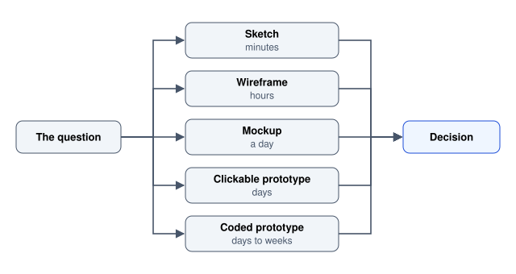

# Prototyping and Handoff

Fidelity levels, Figma mechanics, and getting a design into code without losing the decisions.

Author

Benedict Thekkel

A prototype exists to answer a question before the expensive version gets built. That is the whole purpose, and it is the criterion for every decision about one: **what question is this prototype answering, and what is the cheapest artefact that answers it?**

Most wasted prototyping effort comes from skipping that question. A pixel-perfect mockup of a flow whose structure is wrong is expensive rework. A grey-box wireframe is the right tool for a structural question and the wrong one for a question about whether a chart is readable.



The question to answer can lead to any of five prototype fidelities, a sketch in minutes, a wireframe in hours, a mockup in a day, a clickable prototype in days, or a coded prototype in days to weeks, and each one feeds the same decision.

The second half of this notebook covers handoff, which is the other place design work leaks away: a correct design that reaches code missing its states, its spacing rules and its reasoning.

------------------------------------------------------------------------

## 1. Fidelity: pick the lowest that answers the question

| Fidelity | Answers | Does not answer | Cost |
|----|----|----|----|
| **Sketch** (paper, whiteboard) | Is the structure roughly right? Are there other shapes? | Anything visual or interactive | Minutes |
| **Wireframe** (grey boxes, real hierarchy) | Is the information hierarchy right? Does the flow hold? | Legibility, aesthetics, feel | Hours |
| **Mockup** (full visual design, static) | Does it read correctly? Is the hierarchy visible? | Whether it works to use | A day |
| **Clickable prototype** | Can someone complete the task? Where do they hesitate? | Performance, real data, edge cases | Days |
| **Coded prototype** | Does it work with real data, real latency, real devices? | Nothing much. This is the real thing | Days to weeks |

**Low fidelity invites criticism; high fidelity suppresses it.** A polished mockup gets responses about colour, because it looks finished and people assume the structure is settled. A deliberately rough sketch gets responses about the structure. If you want structural feedback, show something visibly unfinished.

**Sketch more than feels necessary.** The first idea is rarely the best one and the cost of producing a second and third on paper is close to zero. Six rough alternatives in twenty minutes beats one refined screen in two hours, because the value is in the comparison.

**Know when to skip straight to code.** For a change to an existing product with an established design system, building it is often faster than mocking it, and the result is real: real data, real text lengths, real latency, real responsive behaviour. The design-in-Figma step earns its cost when the thing is new, when several people must agree before work starts, or when you want to test with users before committing.

------------------------------------------------------------------------

## 2. Wireframes

Wireframes are about structure: what is on the screen, in what hierarchy, in what order. Strip colour and typography deliberately, because their absence forces the hierarchy to be carried by size, position and spacing, which is where it should come from anyway.

**Use real content, or realistic content.** This is the single most valuable habit in wireframing. Lorem ipsum hides every problem that matters:

- Real labels reveal that your tab names do not fit.
- Real names reveal the one that is 40 characters long.
- Real data reveals the empty case, the single-item case, and the 5,000-row case.
- Real numbers reveal that the chart has no meaningful variation.

**Wireframe the states, not just the ideal screen.** The list from [Interaction Design](../UI_UX/interaction_design.llms.md) section 2 applies here: empty, loading, partial, error, overloaded. Wireframes are cheap, which makes them the right place to work through states rather than discovering them during implementation.

**Annotate behaviour.** A static wireframe cannot show what happens on click, so write it beside the screen. What is the default sort? What happens on a failed save? What is the maximum length of this field? These notes are the part that survives into implementation.

------------------------------------------------------------------------

## 3. Figma mechanics worth knowing

Whatever the tool, four mechanics separate a maintainable file from a pile of rectangles. The names here are Figma’s; Penpot and Sketch have equivalents.

**Auto layout.** Flexbox, in the design tool. Frames size to their content, with padding and gaps that hold as content changes. Without it, a longer label breaks the mockup and somebody nudges rectangles by hand.

Use it for everything: buttons that grow with their label, lists that reflow, cards that stack. The payoff is that your mockup behaves like the CSS it will become, so problems surface in the design rather than after.

**Components and instances.** One master, many instances, edits propagate. The discipline is to make a component as soon as something appears twice, not the third or fourth time, because retrofitting means finding every copy.

**Variants.** One component with properties rather than fifteen separate components:

``` text
Button
  variant:  primary | secondary | ghost | danger
  size:     sm | md | lg
  state:    rest | hover | focus | disabled
  icon:     none | start | end
```

Variants force you to enumerate the state matrix, which is exactly the enumeration developers need and the one most often missing from a handoff. If focus does not appear in the variant list, it will not appear in the code either.

**Variables (design tokens).** Figma variables hold colour, number, string and boolean values with modes, so one file supports light and dark, and compact and comfortable density, from the same components. This is the design-side half of [Design Systems and Tokens](../UI_UX/design_systems_and_tokens.llms.md), and the two should share names so a conversation about `color-action` means the same thing to everyone.

**Constraints and resizing.** Set how layers respond when their frame changes size, then actually resize the frame to check. A mockup that only holds at one width is a screenshot.

**File hygiene that pays for itself.** Name layers as you would name code. One page per flow, with a cover page saying which frames are current. Delete explorations or move them to an archive page, because the most expensive handoff defect is a developer building from a superseded frame that was never removed.

------------------------------------------------------------------------

## 4. Clickable prototypes

A prototype becomes clickable when the question is about behaviour: can a person complete this task, and where do they hesitate?

**Prototype the path you are testing, not the product.** Wire the one flow the test needs, at the depth the test needs. Prototyping every branch takes days and is wasted, since a usability test follows one path at a time.

**Practicalities that matter in testing.**

- **Make dead ends explicit** to yourself and handle them in the script. A participant clicking something unwired should get “that is not built yet, what were you expecting?”, which is itself a finding.
- **Use real interaction where the interaction is the question.** A real text input beats a click that reveals pre-typed text, if what you are testing is a form.
- **Include the failure path.** The most valuable five minutes of most tests is watching someone hit an error.
- **Keep transitions honest.** Instant navigation in a prototype hides the latency that will exist in production, and latency changes behaviour.

**What a prototype cannot tell you.** Real performance, real data volumes, real text lengths in other languages, real device behaviour, and anything about long-term use. A prototype tests comprehension and first-run flow. Everything else needs the built thing.

**Prototype with the real content again.** A prototype filled with “Lorem ipsum” and “John Smith” tests a product that does not exist.

------------------------------------------------------------------------

## 5. Handoff: what a developer actually needs

The failure mode is not a missing mockup. It is a mockup with no answers to the questions that come up during implementation. A good handoff is less about pixel specification (the tool can measure) and more about **decisions and rules**.

**What to supply.**

| Item | Why |
|----|----|
| **Every state** of every component: rest, hover, focus, active, disabled, loading, error | The most commonly missing thing. If it is not in the file it will be improvised |
| **Every screen state**: empty, filtered-empty, loading, partial, error, overloaded | Same reason. See [Interaction Design](../UI_UX/interaction_design.llms.md) |
| **Responsive behaviour**: what happens between and beyond the mocked widths | A mockup at 1440 px and 390 px leaves 1000 px undefined |
| **Token names, not hex values** | “`color-action`” is implementable and maintainable; “#2563EB” invites a hard-coded literal |
| **Spacing as scale steps** | “`space-4`” rather than “16 px”, so the system stays intact |
| **Real copy, final** | Placeholder text ships. It genuinely does |
| **Interaction notes**: validation timing, default sort, focus behaviour, keyboard keys | None of this is visible in a static frame |
| **Edge cases**: longest string, zero items, one item, thousands, no permission, offline | Cheap to state, expensive to discover late |
| **Accessibility intent**: heading levels, accessible names for icon buttons, focus order, live-region announcements | Otherwise it is inferred, or omitted |

**Annotate the frame, do not rely on a conversation.** A verbal explanation is not available at 6 pm three weeks later when the developer hits the case.

**Specify rules rather than measurements where you can.** “Cards are a minimum of 16 rem and fill the row” is implementable at every width. “Three cards of 320 px” is true at one width only.

**Talk before the design is finished.** The most effective handoff is not an event. A developer looking at a half-finished design will say “that layout is hard but this variant is free”, and that information is worth more before the design is final than after. Treat handoff as a checkpoint in a continuing conversation, not a throw over a wall.

**Expect and welcome the return trip.** Implementation reveals things design cannot: an animation that stutters, a state nobody enumerated, an API that cannot supply a field. A design that cannot be adjusted during implementation is a design that will be adjusted without you.

------------------------------------------------------------------------

## 6. Design review and critique

Review is where a design gets better or gets politely approved. The difference is structure.

**Frame the ask.** Open with the question you want answered and the fidelity of the work. “This is structural, I want to know whether the two-column split is right, ignore the colours” prevents an hour of colour feedback.

**Critique the work against goals, not against taste.** The useful form is *observation, then consequence, then question*:

``` text
Weak      I do not like the sidebar.
Better    The sidebar holds four of the five primary actions, but the mockup's task is
          creating a report, and that action is the only one in the main area.
          Was that deliberate?
```

**Separate the reviews.** A design review (does this solve the problem?), a content review (are the words right?) and an accessibility review (contrast, focus, semantics, names) ask different questions, and merging them means the loudest one wins. An accessibility review in particular has a checklist and should be run as one.

**Record decisions and their reasons.** The reason is the durable part. Six months later nobody remembers why the wizard has four steps rather than one page, so the question gets reopened. A line in the file or the ticket prevents it.

**Design QA before release.** Once built, compare against the design with the states in hand: keyboard through it, check focus visibility, check the empty and error states, check 200 percent zoom, check the longest string, check dark mode. This pass catches the gap between “matches the mockup” and “works”, and it is the last cheap opportunity.

------------------------------------------------------------------------

## 7. How prototyping and handoff fail

- **High fidelity too early**, which buys colour feedback on a structural question and makes the work expensive to discard.
- **Lorem ipsum**, hiding every length, emptiness and overflow problem until implementation.
- **Only the ideal state exists in the file.** The single most common handoff defect.
- **Two mocked widths and nothing about the space between.**
- **Hex values instead of token names**, which reintroduces hard-coded colours and quietly defeats theming.
- **Superseded frames left in the file**, so a developer builds the wrong version and is not wrong to.
- **Handoff as an event**, with no conversation until the design is final and every constraint is a surprise.
- **Prototyping every branch**, spending days on paths no test will follow.
- **A design that cannot be built as drawn**, discovered late because nobody asked earlier.
- **No record of why.** The decisions survive; the reasoning evaporates, and the same argument recurs.
- **Design QA skipped**, so the difference between the mockup and the shipped behaviour is found by users.

------------------------------------------------------------------------

## Where this goes next

- [Design Systems and Tokens](../UI_UX/design_systems_and_tokens.llms.md) is what makes handoff cheap, because a design expressed in existing components and tokens needs far less specification.
- [Interaction Design](../UI_UX/interaction_design.llms.md) is the source of the state list that a handoff must cover.
- [Usability Evaluation](../UI_UX/usability_evaluation.llms.md) is what the clickable prototype is for.
- [Accessibility](../UI_UX/accessibility.llms.md) covers the review checklist referenced above.
- [Process and Ethics](../UI_UX/process_and_ethics.llms.md) covers where prototyping sits in a delivery process and how design work is organised.

Implementation: [React Overview](../React/react_overview.llms.md) and [React Libraries](../React/react_libraries.llms.md) for building the components a handoff describes, [CSS](../css.llms.md) for the layout mechanics auto layout maps onto, and [Streamlit](../1_streamlit.llms.md) or [Gradio](../2_gradio.llms.md) when a coded prototype in Python is faster than a clickable one in a design tool.

------------------------------------------------------------------------

Back to top
