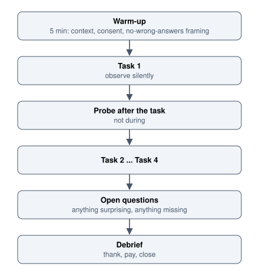

# Usability Evaluation

Finding out whether it works: heuristic review, usability testing, severity and what to report.

Author

Benedict Thekkel

Evaluation answers a different question from research. [UX Research](../UI_UX/ux_research.llms.md) asks whether you are building the right thing. Evaluation asks whether the thing you built can actually be used.

The methods divide into two families, and the distinction matters because they find different problems:

| Family | Who performs it | Finds | Cost |
|----|----|----|----|
| **Inspection** (heuristic evaluation, cognitive walkthrough, accessibility audit) | Someone who knows the guidelines | Known violations, quickly | Hours |
| **Empirical** (usability testing) | Real users attempting real tasks | Problems nobody predicted | Days |

**Do both, in that order.** Inspection is cheap, so use it to clear the obvious defects first. Otherwise you spend expensive test sessions watching five people fail on a missing label you could have found in ten minutes.

**The single most important fact about usability testing: five participants find most of the problems.** The curve of problems-found against participants rises steeply and flattens, so three rounds of five people across three iterations beats one round of fifteen, because you get to fix things in between.

------------------------------------------------------------------------

## 1. Heuristic evaluation

An expert walks the interface against a checklist and records violations. Fast, cheap, and does not need participants.

**The list is Nielsen’s ten, covered in [Interaction Design](../UI_UX/interaction_design.llms.md) section 9.** Keep it beside you and name the number for each finding, because naming it forces the finding to be a principle violation rather than a preference.

**Method.**

1.  **Define the tasks** you will walk, in the user’s language. Evaluating “the settings page” produces vague findings; evaluating “change the alert threshold for one site” produces specific ones.
2.  **Walk each task twice.** First to learn the flow, second to evaluate it, because the first pass is contaminated by figuring out where things are.
3.  **Record each violation** with the screen, the heuristic number, what a user would do, and a severity.
4.  **Use three to five evaluators independently, then merge.** A single evaluator finds roughly a third of the issues. The overlap between evaluators is surprisingly small, which is why independence before merging matters.

**What it is good at:** missing feedback, inconsistency, poor error messages, unclear labels, missing states, violations of convention.

**What it cannot do:** tell you what real users will misunderstand. An expert knows too much, and the most important finding in most tests is a mental model nobody on the team had considered. Heuristic evaluation is a filter, not a substitute.

**A related lightweight method is the cognitive walkthrough**, which asks four questions at every single step of a task: will the user be trying to do this, will they see the control, will they recognise it as the right one, and will they understand the feedback afterwards. Slower per screen and excellent for first-run experiences, because it models a user with no prior knowledge.

------------------------------------------------------------------------

## 2. Usability testing: the shape of a session

One participant, one facilitator, realistic tasks, thinking aloud, 45 to 60 minutes.



Usability session in order from top to bottom: a five-minute warm-up covering context, consent and no-wrong-answers framing, task 1 observed silently, probing after the task rather than during it, tasks 2 to 4, open questions about anything surprising or missing, and a debrief to thank, pay and close.

**Moderated versus unmoderated.**

|  | Moderated | Unmoderated |
|----|----|----|
| Depth | You can probe the unexpected | Fixed script only |
| Cost per session | High | Low |
| Volume | 5 to 8 | 20 to 100 |
| Best for | New flows, complex domains, anything surprising | Comparing two designs, validating a known flow, benchmarking |
| Main risk | Facilitator influence | Misunderstood tasks with nobody to notice |

Start moderated to learn what the problems are, then go unmoderated to measure how common they are. Doing it the other way round produces clean numbers about the wrong question.

**Remote is fine.** Remote moderated sessions over screen share are close enough to in-person for most software, and they widen the pool of participants enormously. The loss is peripheral context: what else is on their desk, who interrupts them, what the room is like. If the environment matters, go there (see contextual inquiry in [UX Research](../UI_UX/ux_research.llms.md)).

------------------------------------------------------------------------

## 3. Writing tasks

Task wording determines what you learn. A leaky task gives away the answer and the session finds nothing.

**Rules.**

- **Give a goal and a context, not instructions.** The task must not name the control.
- **Use the participant’s language**, never your interface labels. If your menu says “Entities” and the task says “entities”, you have just taught them your vocabulary and destroyed the labelling finding.
- **Make it realistic and specific.** A scenario with a reason is engaged with; an abstract instruction is followed mechanically.
- **Define what done looks like** for your own scoring, without telling the participant.

``` text
Bad    Click Settings, then Alerts, and change the threshold to 500.
       (Tests nothing. You have given the path.)

Bad    Explore the alerts feature.
       (No goal, so no success or failure, and no hesitation to observe.)

Good   You have been getting woken up by alerts from the Herston site that turn out
       not to matter. You want to stop being notified unless usage goes above 500 kWh.
       Show me how you would do that.
```

**Order tasks carefully.** Early tasks teach the interface, so a later task benefits from that learning. Put the first-run questions first, and if you need several independent first impressions, use different participants rather than the same one.

**Three to five tasks per session.** More than that and fatigue degrades the data.

------------------------------------------------------------------------

## 4. Facilitating

The facilitator’s job is to get out of the way. Most bad test data comes from the facilitator, not the participant.

**Say this at the start, and mean it.**

> “We are testing the software, not you. If something is confusing, that is a problem with our design and exactly what we need to find. Please think out loud as you go, and tell me what you expect to happen before you click. If you get stuck, that is useful information, so tell me what you are thinking rather than what you think I want to hear.”

**Then be quiet.** The hardest skill in the method is silence. When a participant hesitates, wait. The pause feels much longer to you than to them, and what they say after five seconds of silence is usually the finding.

**Do not help.** Helping is the strongest instinct in the room and it destroys the data. If they are stuck, first ask “what are you trying to do?” and “what would you expect to happen?”. Only assist once the task is genuinely dead, and record that the task failed.

**Never explain the design.** The moment you explain, you have converted a participant into a reviewer, and everything after is contaminated.

**Deflect questions back.** “What do you think that does?” and “what would you expect?” are the two most useful sentences a facilitator has.

**Echo, do not lead.** Repeat their words neutrally (“you said you were looking for a save button”) rather than supplying interpretation.

**Watch for and note these specifically**, because they are the findings:

- Long pauses, and where the cursor wanders.
- Clicking something that is not clickable.
- Reading the same label twice.
- Scrolling past the thing they need.
- Saying “I would probably ask someone” or “I would just do this in Excel”.
- Completing the task while describing it as wrong.

**Record both preference and performance, and expect them to disagree.** Participants routinely say they prefer the design they performed worse on. Report both, and prefer the behaviour when deciding.

------------------------------------------------------------------------

## 5. What to measure

Qualitative observation is the main output, but a few numbers make findings comparable across rounds.

| Metric | How | Notes |
|----|----|----|
| **Task success** | Binary, or a three-point scale (success, success with difficulty, failure) | Define success before the session, not after |
| **Time on task** | Stopwatch | Meaningful only for comparisons, and only when the task is identical |
| **Errors** | Count of wrong actions needing recovery | More diagnostic than time |
| **Assists** | Times the facilitator had to intervene | A blunt but honest measure |
| **Single Ease Question (SEQ)** | One 7-point question after each task: how difficult was that? | Extremely cheap, surprisingly sensitive, and per-task, which is why it beats an end-of-session score for diagnosis |
| **SUS** | 10-item questionnaire at the end, scored 0 to 100 | Comparable across products. Around 68 is average; treat above 80 as good. Not diagnostic |

**SUS is a benchmark, not a diagnosis.** It tells you whether the product is broadly usable relative to others; it cannot tell you what to fix. Use it to track a redesign across versions, and use observation to decide what to change.

**Be honest about statistics with five participants.** Four out of five is not 80 percent of your users, it is four people. Report counts (“four of five participants could not find the export”) rather than percentages, which imply a precision you do not have.

------------------------------------------------------------------------

## 6. Severity, and choosing what to fix

Findings without severity become a flat list nobody can act on. Rate each on frequency, impact and persistence.

| Severity | Definition | Response |
|----|----|----|
| **4 Critical** | Blocks task completion, or causes data loss | Fix before release |
| **3 Major** | Significant delay or frustration; most users hit it | Fix in this cycle |
| **2 Minor** | Noticed, worked around, causes irritation | Backlog with a date |
| **1 Cosmetic** | Inconsistency with no functional cost | Fix opportunistically |

**Weight by frequency of the task, not just of the failure.** A minor annoyance in a flow used forty times a day outranks a major problem in an annual one.

**Separate the finding from the solution.** Report “four of five participants looked for export in the toolbar and did not find it in the overflow menu”. Do not report “move export to the toolbar”. The first is evidence and is not arguable; the second is a proposal that invites a debate about the proposal instead of the problem, and it may not even be the best fix.

**Watch for the finding that is really a research finding.** If participants complete the task easily and then say they would not use the feature, the usability is fine and the problem is upstream. That belongs back in [UX Research](../UI_UX/ux_research.llms.md), and no amount of interface polish will address it.

------------------------------------------------------------------------

## 7. Reporting so that something changes

The most common failure of evaluation is not method, it is that nothing happens afterwards.

**Video clips beat every other format.** Thirty seconds of a real person failing to find a button ends an argument that a paragraph cannot. Cut two or three clips per major finding and lead with them.

**Keep the report short and structured.** One page per finding at most: what happened, how many participants, a clip or screenshot, severity, and the affected task. A forty-page deck is a way of not being read.

**Run a 20-minute walkthrough with the team, and invite them to watch sessions live.** A developer who watched one participant struggle needs no report at all, and this is by far the most effective way to build a team that cares about the findings.

**Attach findings to decisions.** A finding filed as a ticket with a severity and an owner gets fixed. The same finding in a document gets acknowledged.

**Report what worked too.** A finding that a flow tested cleanly is information, and it prevents a team redesigning something that was fine.

**Close the loop.** Retest the fix in the next round. A surprising number of usability fixes introduce a new problem, and you will only know if you look.

------------------------------------------------------------------------

## 8. Accessibility audits and testing with disabled participants

An accessibility audit is inspection against WCAG rather than against usability heuristics, and it is a separate pass with its own checklist. The mechanics are in [Accessibility](../UI_UX/accessibility.llms.md) section 10: automated tooling such as axe for what can be machine checked, then manual keyboard, zoom, greyscale and screen reader passes for the two thirds that cannot.

**Conformance is not usability.** A page can pass every automated check and still be miserable to use with a screen reader: a correct but nonsensical tab order, accurate alt text that describes the wrong thing, a form that is technically labelled and practically incomprehensible. Only a person using their own assistive technology finds these.

**So include disabled participants in ordinary usability testing**, not only in a separate audit.

- Recruit through disability organisations and specialist panels rather than a general participant pool.
- **Let them use their own setup.** Their screen reader, their settings, their speech rate, their magnification level. An unfamiliar configuration tests the configuration, not your product.
- Expect a different pace and navigation strategy. Experienced screen reader users navigate by headings and landmarks at speeds that will surprise you, which is also why heading structure findings come out of these sessions so clearly.
- Budget longer sessions, and pay properly.
- Do not treat the session as an accessibility audit. They are a user with a task, and the findings will include ordinary usability problems alongside access barriers.

------------------------------------------------------------------------

## 9. How evaluation fails

- **Testing too late**, when the findings can no longer change anything. A test the week before release is a list of things you will ship anyway.
- **The facilitator helping.** The most common data-destroying habit.
- **Leading tasks** that name the control and therefore test nothing.
- **Testing with colleagues.** They know the product, the vocabulary and the intent, so they cannot be surprised by it.
- **Only testing the happy path**, leaving the error and empty states unexamined, which is where users actually struggle.
- **Percentages from five participants**, implying precision that does not exist.
- **Findings without severity**, producing a flat list that gets triaged by whoever shouts.
- **Reporting solutions instead of observations**, which turns a factual finding into a debatable proposal.
- **No retest**, so nobody knows whether the fix worked.
- **Treating an automated accessibility scan as an accessibility test.** It catches about a third.
- **One round only.** The value of the method is iteration, and a single round wastes most of it.

------------------------------------------------------------------------

## Where this goes next

- [Measurement and Experimentation](../UI_UX/measurement_and_experimentation.llms.md) is the quantitative counterpart: usability testing tells you why, analytics and A/B tests tell you how many.
- [UX Research](../UI_UX/ux_research.llms.md) is where a finding goes when it turns out to be about the wrong problem rather than the wrong interface.
- [Information Architecture](../UI_UX/information_architecture.llms.md) holds tree testing and card sorting, which are structural evaluation methods.
- [Accessibility](../UI_UX/accessibility.llms.md) holds the audit checklist and the manual testing passes.
- [Process and Ethics](../UI_UX/process_and_ethics.llms.md) covers consent, incentives and participant data.

------------------------------------------------------------------------

Back to top
