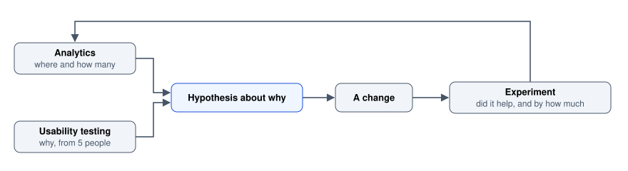

# Measurement and Experimentation

Instrumentation, funnels, A/B tests and the frameworks that keep the numbers honest.

Author

Benedict Thekkel

Measurement tells you **how many** and **how often**. It cannot tell you **why**, and the most common failure in this whole area is expecting it to.

The pairing that works: analytics finds where people drop out, then a handful of usability sessions explain it. Either half alone produces confident wrong conclusions. Analytics alone gives you a cliff in a funnel and a team inventing explanations for it; usability testing alone gives you a vivid problem with no idea whether it affects 2 percent or 60 percent of users.



Measurement loop: analytics (where and how many) and usability testing (why, from 5 people) both feed a hypothesis about why, which leads to a change, then an experiment on whether it helped and by how much, which feeds back into analytics.

------------------------------------------------------------------------

## 1. Instrumentation: design the events before you need them

Analytics is only as good as its event schema, and a schema is very hard to fix retrospectively because historical data cannot be recovered.

**Decide what question each event answers.** An event that no question needs is noise that costs storage, review time and privacy exposure.

**Use a consistent naming convention**, `object_action` in past tense, lower snake case:

``` text
report_exported
alert_threshold_changed
site_created
signup_completed
invite_accepted
```

Not `clickExport`, `Export Report`, `export-btn-2`. Mixed conventions make every query an archaeology exercise.

**Put the interesting information in properties, not in the event name.** One event with properties beats fourteen events:

``` js
track('report_exported', {
  format: 'csv',            // csv | xlsx | pdf
  row_count: 4820,
  date_range_days: 90,
  source: 'toolbar',        // toolbar | overflow_menu | keyboard_shortcut
  duration_ms: 1840,
});
```

That `source` property is the kind that earns its keep: it answers “is anyone finding the keyboard shortcut” without a new event.

**Track outcomes, not only clicks.** `export_button_clicked` tells you about intent; `report_exported` with a `duration_ms` tells you about success. Instrument the completion and the failure of anything that can fail.

**Document the schema and review additions.** Without review, four people add four events for the same action within a year and the numbers stop agreeing.

**Collect the minimum.** Every property is a privacy liability and a maintenance cost. Never put personal data in event properties, do not log full URLs containing tokens or identifiers, and respect consent state before sending anything. See [Process and Ethics](../UI_UX/process_and_ethics.llms.md).

------------------------------------------------------------------------

## 2. Funnels

A funnel counts how many people get from one step to the next. It is the single most useful analytics view for design work because it localises the problem.

| Step                 | Users  | Conversion | Drop  |
|----------------------|--------|------------|-------|
| Visited signup       | 10,000 |            |       |
| Started the form     | 4,100  | 41%        | 5,900 |
| Submitted the form   | 3,400  | 83%        | 700   |
| Verified email       | 1,900  | 56%        | 1,500 |
| Completed setup      | 1,500  | 79%        | 400   |
| Created first report | 620    | 41%        | 880   |

**Read the biggest proportional drop, not the biggest absolute one.** Here the 56 percent email verification step is the standout: it is a mechanical step with no value to the user, and losing 44 percent of people there usually means a deliverability or expectation problem rather than a design one. Check the spam folder theory before redesigning the screen.

**Segment before concluding.** An aggregate funnel hides the real shape. Split by new versus returning, device, acquisition channel, country and plan. A step that looks mediocre overall is frequently fine on desktop and broken on mobile, and the aggregate averages the two into a number that describes nobody.

**Define whether your funnel is strict or loose.** Must the steps happen in order, in one session, within a time window? The same data produces very different funnels depending on the answer, so fix the definition and write it down.

**Instrument the drop-out, not just the progress.** Knowing 1,500 people never verified is the start. Knowing how many verification emails bounced, how many were opened, and how many links expired is the answer.

------------------------------------------------------------------------

## 3. Session replay and heatmaps

**Session replay** reconstructs an individual session. Its value is the qualitative detail behind a quantitative anomaly: watch ten sessions that dropped at the step your funnel flagged and the cause is often immediately obvious.

Use it to investigate a known problem, never to browse. Watching random sessions is an enormous time sink with a low yield.

**Privacy is not optional here.** Replay captures what people type. Mask every input by default, exclude payment and authentication screens entirely, honour consent, and set a short retention period. A replay tool configured carelessly is a data breach waiting for an audit.

**Heatmaps** aggregate behaviour across many sessions.

| Type | Shows | Main trap |
|----|----|----|
| Click map | Where people click | Clicks on non-interactive elements are a finding, not noise: it means something looks clickable |
| Scroll map | How far down people get | Fold position varies by viewport, so segment by device |
| Attention or move map | Where the cursor lingers | Cursor position is a weak proxy for gaze |

**Heatmaps describe, they do not explain.** A cold region might be ignored, or might be perfectly understood at a glance and require no interaction. A hot region might be engaging, or confusing. Both need a hypothesis and another method to confirm it.

**Clicks on dead elements are the most actionable output** of a click map, because they point straight at a signifier problem (see [Interaction Design](../UI_UX/interaction_design.llms.md) section 3).

------------------------------------------------------------------------

## 4. A/B testing

An A/B test compares variants on live traffic to establish which performs better on a defined metric. It is the only method that gives a causal answer, and it is easy to run badly.

**Start with a hypothesis, not a variant.** The format that keeps a test honest:

> Because we observed **\[evidence\]**, we believe that **\[change\]** will cause **\[measurable effect\]** for **\[segment\]**. We will know this is true when we see **\[metric moves by X\]**.

Without the “because we observed”, you are guessing, and a test of a guess has a low hit rate at high cost.

**Decide the sample size before you start.** Working roughly: detecting a relative improvement of 5 percent on a 10 percent baseline conversion needs on the order of tens of thousands of users per variant. Detecting 20 percent needs a few thousand. Run the calculation for your own numbers before committing, because the common outcome of skipping it is a three-week test that could never have reached significance.

**Do not peek and stop early.** Checking daily and stopping when the result crosses significance inflates the false positive rate substantially, because you are taking many chances at the threshold. Fix the duration and the sample size in advance, or use a sequential testing method designed for continuous monitoring.

**Run for at least one full business cycle**, usually one or two weeks. Weekday and weekend behaviour differ, and a test run Monday to Thursday measures Monday-to-Thursday users.

**Set guardrail metrics.** A variant that raises signups and also raises refunds, support contacts or uninstalls is not a win. Decide before the test which metrics must not degrade.

**What A/B testing cannot do.**

- **Explain why.** It gives a verdict with no mechanism.
- **Escape a local maximum.** Incremental tests optimise the current design and will never find a better one. Use research and qualitative work for the step change, experiments for the refinement.
- **Measure long-term effects** within a short test. A dark pattern reliably wins a two-week conversion test and loses over a year through churn and reputation.
- **Work at low traffic.** With hundreds of users a week you cannot detect a realistic effect. Use qualitative methods and sound judgement instead, which is the honest answer for most products.

**Ethical limits apply.** Experimenting on people has boundaries: no tests that deceive users into paying more, no tests that withhold safety or accessibility features, no experiments on vulnerable groups without proper review. See [Process and Ethics](../UI_UX/process_and_ethics.llms.md).

------------------------------------------------------------------------

## 5. Frameworks that stop metric sprawl

**HEART** (Google) gives five categories, and its real contribution is the goals, signals, metrics chain that forces you to derive each metric from a goal:

| Dimension | Question | Example metric |
|----|----|----|
| **Happiness** | How do people feel? | SUS, satisfaction rating, SEQ |
| **Engagement** | How much do they use it? | Sessions per active user per week |
| **Adoption** | Are new people starting? | New users completing setup |
| **Retention** | Do they come back? | Percentage still active at week 4 |
| **Task success** | Can they do the thing? | Completion rate, time on task, error rate |

Pick one or two dimensions per project rather than all five. A feature aimed at retention should not be judged on engagement.

**Goals, signals, metrics.** For each dimension: state the goal in words, name the observable signal, then define the precise metric. This is the step that prevents the usual pattern of measuring whatever the analytics tool happens to offer.

**Core Web Vitals** are the performance metrics with a direct experience meaning, covered in [Responsive and Multiplatform](../UI_UX/responsive_and_multiplatform.llms.md) section 8 and [Website Metrics](../0_website_metrics.llms.md).

| Metric                          | Good threshold |
|---------------------------------|----------------|
| LCP (largest contentful paint)  | under 2.5 s    |
| INP (interaction to next paint) | under 200 ms   |
| CLS (cumulative layout shift)   | under 0.1      |

**Measure the field, not the lab.** A Lighthouse score on a fast laptop tells you little about a user on a mid-range phone on mobile data. Use real-user monitoring and look at the 75th percentile, not the average, because the average hides exactly the users having a bad time.

------------------------------------------------------------------------

## 6. Attitudinal metrics: SUS, NPS, CES

Three questionnaires that come up constantly. Each measures something narrow, and each gets over-read.

| Instrument | Question | Use | Limit |
|----|----|----|----|
| **SUS** | 10 items on usability, scored 0 to 100 | Benchmark a redesign against the previous version | Not diagnostic; says nothing about what to fix |
| **NPS** | “How likely are you to recommend …?” 0 to 10 | A single tracked number for executives | Crude, heavily criticised statistically, insensitive to product change |
| **CES** | “How easy was it to …?” | Per-interaction friction, right after the task | Only meaningful immediately after the task |
| **SEQ** | One 7-point difficulty question per task | The cheapest useful per-task measure in usability testing | Per-task only |

**SUS around 68 is average.** Above 80 is good, and the value is in tracking the same product over time rather than comparing across very different product categories.

**NPS deserves particular caution.** Collapsing an 11-point scale into three buckets and subtracting discards most of the information, the score moves for reasons unrelated to the product, and it is insensitive to exactly the interface improvements you care about. If your organisation tracks it, the **free-text follow-up is the valuable part**, not the number.

**The general rule for all of them: the comment box outperforms the score.** A number tells you something changed; the comments tell you what.

------------------------------------------------------------------------

## 7. Pitfalls

- **Vanity metrics.** Page views, total registered users, raw session counts. They rise over time regardless of quality, so they cannot inform a decision. Prefer rates and cohort-based measures.
- **Goodhart’s law.** Once a metric is a target it stops measuring what it measured. Optimise for time-on-page and you get a slower interface; optimise for tickets closed and you get tickets closed prematurely.
- **Averages hiding the distribution.** An average load time of 2 s can mean everyone at 2 s or half at 0.5 s and half at 4 s. Use percentiles, and look at the 75th and 95th.
- **Survivorship bias.** Every in-product survey and satisfaction score only reaches people still using the product. The ones who left hold the information you most need.
- **Correlation read as causation.** Users of feature X retain better, therefore push feature X to everyone. Usually the causation runs the other way: engaged users find the feature.
- **Simpson’s paradox.** A variant can win in every segment and lose overall, or the reverse, when segment sizes shift between variants. Always check the segments.
- **Novelty and primacy effects.** A new design gets attention because it is new, and existing users get worse before they get better. Both fade, and both distort a short test.
- **Measuring what the tool offers** rather than what the goal requires. This is the failure HEART’s goals, signals, metrics chain exists to prevent.
- **Instrumenting everything just in case.** Cost, noise, and a privacy liability with no question attached.
- **Optimising a local maximum forever.** A hundred successful button tests will not produce a better product architecture.

------------------------------------------------------------------------

## Where this goes next

- [Usability Evaluation](../UI_UX/usability_evaluation.llms.md) is the qualitative half. Analytics finds the cliff; five sessions explain it.
- [UX Research](../UI_UX/ux_research.llms.md) covers surveys and sampling, which apply directly to every attitudinal metric here.
- [Responsive and Multiplatform](../UI_UX/responsive_and_multiplatform.llms.md) covers Core Web Vitals as design constraints.
- [Process and Ethics](../UI_UX/process_and_ethics.llms.md) covers consent, data minimisation, and the limits of experimenting on people.

Implementation: [Website Metrics](../0_website_metrics.llms.md) for the analytics and heatmap tooling landscape, [Google Analytics](../1_google_analytics.llms.md) for wiring GA into a Django project, and [SEO](../SEO/seo.llms.md) for the search-visibility side of the same measurements.

------------------------------------------------------------------------

Back to top
