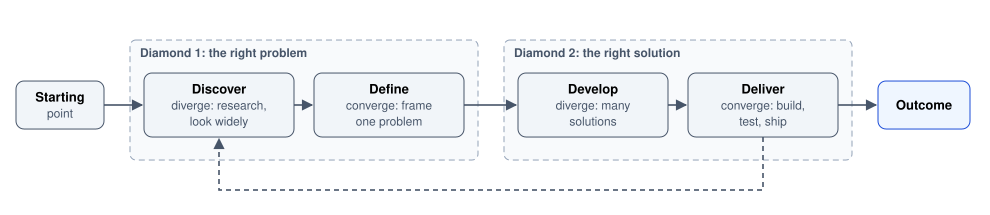
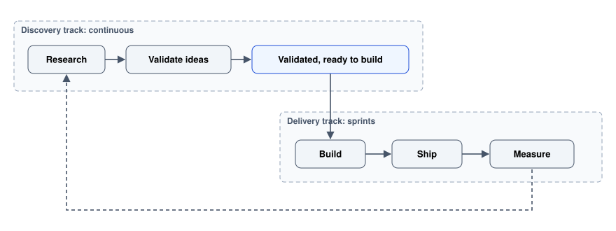

# Process and Ethics

How design work is organised, and the lines it should not cross.

Author

Benedict Thekkel

Two subjects that decide whether the rest of this collection gets used. **Process** is how design work fits into delivery, which determines whether research happens before decisions or after them. **Ethics** is the set of limits on what you build, which matters most precisely when a metric says the unethical version performs better.

The process half is deliberately short, because process is the part most likely to be prescribed by someone else and least likely to be improved by adding ceremony. The useful content is the small number of ideas worth stealing from each framework.

------------------------------------------------------------------------

## 1. The double diamond

The most useful process diagram in design, from the UK Design Council. Two diamonds: the first finds the right problem, the second finds the right solution, and each has a diverging and a converging half.

Double diamond from starting point to outcome: the first diamond diverges in Discover (research, look widely) and converges in Define (frame one problem), the second diverges in Develop (many solutions) and converges in Deliver (build, test, ship), with a dashed loop from Deliver back to Discover.

**The load-bearing idea is the first diamond.** Most teams start at Develop, because a solution has already been named in the request, so the problem is never framed and never questioned. The discipline of the double diamond is insisting that “add a dashboard” is a proposed solution, and the problem behind it is still unstated.

**Diverge before converging, in both diamonds.** Generate several problem framings and several solutions before narrowing. Teams habitually generate one of each and then refine it, which is how a mediocre first idea becomes a polished mediocre product.

**It is not linear.** Delivery reveals things that send you back to Discover. The diagram is a set of modes, not a schedule.

------------------------------------------------------------------------

## 2. Design thinking, lean UX, and where design sits in delivery

**Design thinking** is the five-mode framing popularised by IDEO and Stanford: empathise, define, ideate, prototype, test. It is essentially the double diamond with different labels, and its contribution is making the modes explicit and nameable in a mixed team.

**It has earned its criticism.** As commonly practised it becomes a workshop ritual: sticky notes, a “how might we”, an afternoon of ideation, and no research and no follow-through. The critique worth taking seriously is that it can substitute the appearance of a process for actual investigation, and that facilitated ideation by people with no domain knowledge produces confident shallow ideas. **Use the modes; skip the theatre.**

**Lean UX** applies the build, measure, learn loop to design: state an assumption, define the smallest thing that would test it, run it, then decide. Its strength is that it treats a design as a hypothesis rather than a specification, which keeps teams from defending a design instead of testing it. Its risk is that “smallest testable thing” degrades into shipping unfinished work to users and calling the complaints data.

**The practical arrangement in an agile team is dual track.**

Dual-track agile: a continuous discovery track runs research, then idea validation, to produce validated work ready to build, which the sprint-based delivery track builds, ships and measures, with a dashed loop from measure back to research.

Discovery runs continuously and feeds a backlog of understood, validated work; delivery pulls from it. The alternative, where design happens inside the same sprint as implementation, guarantees that design is always a sprint behind and always rushed.

**What actually matters more than the framework:**

- **Designers and developers talk daily**, not at a handoff.
- **Research happens before the decision**, not after, so it can still change something.
- **Someone owns the problem**, not just the tickets.
- **Users are seen regularly** by the whole team. A standing cadence, even one session a fortnight, changes a team’s instincts more than any process document.

------------------------------------------------------------------------

## 3. Design ops and keeping it running

Design ops is the unglamorous work that makes design repeatable: tooling, file structure, the component pipeline, research participant recruitment, a shared vocabulary, and documentation of decisions.

**The most valuable pieces, in order.**

1.  **A participant recruitment pipeline.** The single biggest practical blocker to regular research is finding people. A standing panel, a recruiter, or an in-product intercept turns a two-week task into a two-day one, and research frequency is the thing that most improves design quality.
2.  **A decision log.** Not a specification. A short record of what was decided and why, so the same argument is not relitigated every six months. This is the artefact teams most regret not keeping.
3.  **An owned design system**, covered in [Design Systems and Tokens](../UI_UX/design_systems_and_tokens.llms.md).
4.  **A definition of done that includes design QA**, with the keyboard, zoom, empty-state and dark-mode checks from [Prototyping and Handoff](../UI_UX/prototyping_and_handoff.llms.md) section 6.
5.  **A research repository.** Findings that cannot be found are re-gathered. Even a tagged folder of one-page summaries beats nothing.

**Resist adding ceremony.** Design ops fails the same way process fails: by adding meetings and templates instead of removing friction. The test for any new process artefact is whether it saves more time than it costs within a quarter.

------------------------------------------------------------------------

## 4. Dark patterns

A dark pattern is an interface deliberately designed to make a user do something they did not intend. The distinguishing feature is that it works **against** the user’s interest and **for** the business’s, and that it relies on the user not noticing.

| Pattern | What it does |
|----|----|
| **Roach motel** | Easy to get into, hard to get out of. One-click signup, cancellation by phone during business hours |
| **Confirmshaming** | An opt-out worded to shame. “No thanks, I prefer paying full price” |
| **Misdirection** | Visual hierarchy steering the eye to the profitable choice while the neutral one is grey text |
| **Forced continuity** | A free trial that silently becomes a charge, with no reminder |
| **Sneak into basket** | An added item or insurance the user did not select |
| **Privacy Zuckering** | Sharing settings defaulted open, buried, and reset after updates |
| **Hidden costs** | Fees revealed only at the last step, after the effort is sunk |
| **Bait and switch** | The expected outcome of an action is not what happens |
| **Nagging** | Repeated interruption until the user gives in, with no permanent decline |
| **Fake urgency and scarcity** | Countdown timers that reset, “3 people are viewing” fabricated |
| **Trick questions** | Double negatives in consent checkboxes |
| **Obstruction** | Deliberate friction on the path the business does not want |

**Three reasons to refuse them beyond the obvious one.**

- **They are increasingly illegal.** The GDPR requires consent to be freely given, specific and as easy to withdraw as to give. The EU Digital Services Act, the California Consumer Privacy Act and several other regimes name deceptive design specifically. Regulators have issued substantial fines for cookie banners alone.
- **They win in the short run and lose in the long run.** A dark pattern reliably wins a two-week conversion test, which is exactly why A/B testing on a short window is the mechanism that selects for them. The costs arrive later as churn, chargebacks, support load and reputation.
- **They are corrosive internally.** A team that gets used to trading user interest for a metric keeps doing it, and the line moves.

**The useful working test.** Would you be comfortable explaining this design to the user, out loud, in plain words? “We made the cancel link grey and put it in the footer so fewer people find it” fails immediately. A second version of the same test: would this still work if the user fully understood it? Persuasion survives understanding; manipulation does not.

**Distinguish persuasion from manipulation.** Making a good option prominent, defaulting to the safe setting, reducing friction on a useful path: all legitimate. The line is whether the design depends on the user misunderstanding it.

------------------------------------------------------------------------

## 5. Consent, privacy and data in interfaces

Privacy is an interface problem as much as a legal or engineering one, because consent is expressed through a design.

**What valid consent looks like.**

- **Freely given.** Refusing must be as easy as accepting. “Accept all” as a prominent button beside “Manage preferences” as grey text is not equivalence, and regulators have said so explicitly.
- **Specific.** Separate purposes get separate choices. A single toggle covering analytics and advertising is not specific.
- **Unbundled from service.** Access cannot be conditioned on consent to unnecessary processing.
- **Revocable, easily.** Withdrawing must be as simple as granting, and findable later. A banner that appears once and can never be reopened fails this.
- **Opt-in, not pre-ticked.** Pre-checked consent boxes are invalid under the GDPR.

**Design habits that follow.**

- **Collect the minimum.** Every field is a liability. Ask why before adding one.
- **Explain in plain language at the point of collection.** Why this field, what happens to it, who sees it. Explaining at collection time is worth more than a complete privacy policy nobody opens.
- **Default to private.** A sharing setting should start closed, and should not be reopened by a product update.
- **Make deletion real and visible.** If the user can delete an account, say what is deleted, what is retained and for how long.
- **Show what you hold.** An accessible view of the data held about a person is both a legal right in many jurisdictions and a trust mechanism.
- **Mask by default in session replay** (see [Measurement and Experimentation](../UI_UX/measurement_and_experimentation.llms.md) section 3), and never log personal data in analytics event properties.

**Research ethics, which is the same principle applied to participants.**

- **Informed consent** before recording: what is recorded, who sees it, how long it is kept, how to withdraw.
- **The right to stop** at any point, with no consequence and with payment regardless.
- **Pay people** for their time, at a rate that is not insulting.
- **Anonymise in reporting.** Quotes without names, faces blurred in clips shared widely.
- **Store recordings with the same care as production data**, with a defined retention period and actual deletion at the end of it.
- **Do not deceive.** If a study requires any withholding, the withholding must be harmless and the participant must be told at the end.
- **Extra care with vulnerable participants**, including children, people in crisis and anyone whose relationship to you involves a power imbalance, such as your own employees.

------------------------------------------------------------------------

## 6. Inclusive design

**Accessibility and inclusive design are not the same thing.** Accessibility is the outcome of a product being usable by people with disabilities, measured against standards such as WCAG. Inclusive design is the method of designing so that a wide range of people can participate, and it covers far more than disability: language, literacy, numeracy, income, connectivity, device age, gender, age, culture, and circumstance.

**The Microsoft Inclusive Design principles are the clearest framing:**

1.  **Recognise exclusion.** Every design decision includes some people and excludes others. Naming who is excluded is the whole technique.
2.  **Solve for one, extend to many.** Designing for a specific constrained case produces a better general solution. Captions were built for deaf viewers and are now used by most people watching video in public.
3.  **Learn from diversity.** People at the edges of your assumptions are the ones who teach you where the assumptions are.

**The persona spectrum is the most practical tool here.** For any ability, consider permanent, temporary and situational cases, because the situational group is enormous and makes the business case obvious:

| Ability | Permanent | Temporary | Situational |
|----|----|----|----|
| Vision | Blind | Eye surgery recovery | Bright sunlight, driving |
| Hearing | Deaf | Ear infection | Noisy cafe, sleeping baby nearby |
| Motor | Missing arm | Broken wrist | Holding a child, wearing gloves |
| Cognitive | Learning disability | Concussion, medication | Distraction, stress, an unfamiliar language |

**Assumptions worth checking in every design.**

- **Names.** Not everyone has a first and last name, or an alphabet you expected, or fewer than 30 characters.
- **Addresses.** Not every country has postcodes, states, or street numbers.
- **Gender.** If you do not need it, do not ask. If you do, say why and allow more than two options.
- **Literacy and numeracy.** Plain language is an inclusion measure, not only a style preference.
- **Connectivity and device.** A mid-range phone on intermittent mobile data is the realistic baseline for a large share of users, not an edge case.
- **Money.** A design that assumes a credit card, or a data plan without limits, excludes people.
- **Time and attention.** Interfaces are used by exhausted, interrupted people, not by the rested reviewer in a quiet room.

------------------------------------------------------------------------

## 7. How process and ethics fail

**Process.**

- **Design starting at Develop**, with the solution already named in the request and the problem never framed.
- **Research after the decision**, so it can only validate or be ignored.
- **Design inside the delivery sprint**, so it is permanently rushed and permanently behind.
- **Ceremony instead of contact.** Workshops, templates and rituals substituting for talking to users.
- **No decision log**, so the same debates recur indefinitely and institutional memory lives in one person’s head.
- **A designer as a service desk** receiving specifications, which wastes the one role whose job is to question the problem.
- **Accessibility as a release gate** rather than a design constraint, guaranteeing either a rush of last-minute fixes or a waiver.

**Ethics.**

- **The metric deciding.** A short conversion test will reliably prefer the manipulative variant, which is a fact about the measurement window, not about what is right.
- **“Everyone does it.”** True of most dark patterns and irrelevant, and increasingly false as a legal defence.
- **Consent as a compliance artefact**, designed to be accepted rather than understood.
- **Data collected because it is cheap**, creating liability with no question attached.
- **Inclusion treated as a checklist** at the end, rather than an assumption audit at the start.
- **Nobody empowered to say no.** The most important structural point in this notebook: if no one in the process can refuse a manipulative design, the outcome is already decided.

------------------------------------------------------------------------

## Where this goes next

This is the last notebook in the sequence. The threads it ties back to:

- [UX Research](../UI_UX/ux_research.llms.md) is the first diamond in practice, and its participant ethics are section 5 above.
- [Accessibility](../UI_UX/accessibility.llms.md) is the standards half of what section 6 frames as a method.
- [Measurement and Experimentation](../UI_UX/measurement_and_experimentation.llms.md) is where the short-window metric problem in section 7 originates, and where data minimisation applies directly.
- [Prototyping and Handoff](../UI_UX/prototyping_and_handoff.llms.md) holds the design review and design QA practices that section 3 depends on.
- [Design Systems and Tokens](../UI_UX/design_systems_and_tokens.llms.md) covers the governance model that is design ops applied to components.

------------------------------------------------------------------------

Back to top
